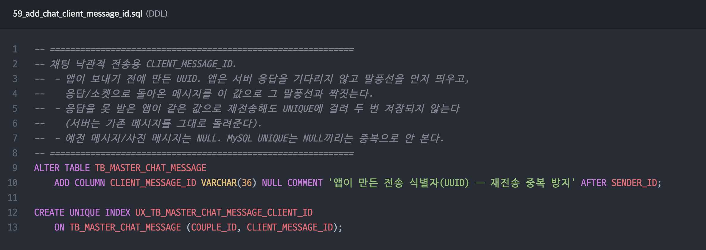

## 개요

- 우린 채팅은 처음에 **서버 응답이 와야** 앱이 말풍선을 띄웠다.
  - 와이파이에선 티가 안 나는데, 지하철이나 엘리베이터에서 보내면 말풍선이 한참 뒤에 뜬다.
  - 그래서 앱이 **누르자마자 말풍선을 띄우고**, 뒤에서 보내도록(낙관적 전송) 바꾸기로 했다.
- 앱이 응답을 기다리지 않으면, 응답을 못 받았을 때 **다시 보내기**가 필요하다. 이때 서버가 답해야 할 질문이 생긴다.
  - 같은 메시지가 두 번 오면 **두 번 저장해도 되나?**
  - 두 번 왔다는 건 **어떻게 알아보나?**
- 결과
  - 앱이 보내기 전에 만든 UUID(`clientMessageId`) 하나와 **UNIQUE 인덱스 하나**로 해결했다.
  - 같은 값으로 몇 번을 다시 보내도 메시지는 한 번만 저장되고, 서버는 처음 저장된 메시지를 돌려준다. 상대에게 실시간 전송과 푸시도 한 번만 나간다.

## 응답을 못 받았다고 실패한 건 아니다

- 앱 입장에서 "전송 실패"는 하나지만, 서버 입장에서는 두 경우가 섞여 있다.
  - 요청이 **서버에 닿지 못했다** → 다시 보내야 한다.
  - 서버는 **저장까지 끝냈는데 응답이 돌아가다 끊겼다** → 다시 보내면 안 된다.
- 앱은 이 둘을 구분할 수 없다. 둘 다 타임아웃이나 네트워크 에러로 보인다.
- 그래서 "다시 보내기"를 허용하려면 **같은 요청을 여러 번 받아도 결과가 한 번 받은 것과 같아야** 한다. (멱등성)
  - 앱이 판단할 수 없으니, 판단은 서버가 해야 한다.
  - 서버가 판단하려면 "이건 아까 그 요청이다"를 알아볼 **식별자**가 요청에 실려 있어야 한다.
- 서버가 주는 `message_id`는 쓸 수 없다. 저장이 끝나야 생기는 값이라, 응답을 못 받은 앱은 그 값을 모른다.
  - 결국 **앱이 보내기 전에 만들고, 재전송 때도 똑같이 보내는** 값이 필요하다.

## 해결: 앱이 만든 UUID를 UNIQUE로

- `CLIENT_MESSAGE_ID`는 앱이 만든 UUID다. 길이가 고정(36자)이라 `VARCHAR(36)`.
- UNIQUE는 `(COUPLE_ID, CLIENT_MESSAGE_ID)`로 걸었다.
  - UUID는 사실상 겹치지 않지만, 범위를 커플로 좁혀 두면 "다른 커플의 메시지와 충돌"이라는 경우 자체를 생각할 필요가 없다.
  - 앞 컬럼이 `COUPLE_ID`라, 중복일 때 기존 메시지를 찾는 조회도 이 인덱스를 그대로 탄다.
- 컬럼은 **NULL 허용**이다.
  - 예전 메시지, 사진 메시지(업로드가 먼저 끝나야 보낼 수 있어 낙관적 전송 대상이 아니다), `clientMessageId`를 안 보내는 예전 버전 앱은 NULL로 저장된다.
  - MySQL UNIQUE는 NULL끼리는 중복으로 보지 않는다. 그래서 기존 데이터를 손대지 않고 인덱스를 걸 수 있었다.

### 중복이면 저장된 메시지를 돌려준다

- INSERT를 먼저 시도하고, UNIQUE에 걸리면(`DuplicateKeyException`) 이미 저장된 메시지를 찾아서 돌려준다.
- 왜 "먼저 SELECT로 있는지 보고, 없으면 INSERT"로 안 했나?
  - 재전송은 첫 요청이 아직 처리 중일 때도 온다. 두 요청이 동시에 SELECT하면 **둘 다 "없음"을 보고 둘 다 INSERT**한다.
  - UNIQUE 제약에 맡기면 DB가 둘 중 하나만 통과시킨다. 판단을 애플리케이션 코드가 아니라 **DB 제약**에 둔 것이다.
  - 보통은 중복이 아니니, 대부분의 요청은 INSERT 한 번으로 끝난다. 조회가 추가되는 건 재전송일 때뿐이다.
- `clientMessageId`가 없는데 `DuplicateKeyException`이 났다면 이 경우가 아니다. 그때는 예외를 그대로 던진다.

## 저장 다음에 하는 일들

- 메시지 저장 하나에 서버가 하는 일은 저장만이 아니다. 전체 흐름은 이렇다.

1. **저장** (`INSERT`, 중복이면 기존 메시지 반환하고 끝)
2. **저장한 행을 다시 읽는다**
   - 요청 VO에는 앱이 보낸 값만 있다. 읽음 여부(`READ_YN`), 보낸 시각(`FST_RG_DTM`)처럼 **DB 기본값**으로 채워지는 컬럼은 비어 있다.
   - 다시 읽지 않으면 응답과 실시간 전송에 이 값들이 빠진다. ([이 문제로 실제로 겪은 일](/project/2026/11/23/Woorin-Silent-Failures/))
3. **커플 방에 웹소켓으로 전송** (`MESSAGE` 이벤트, 보낸 사람 본인 포함)
4. **상대에게 푸시** (`@Async`로 별도 스레드)
5. 응답
- 중복 요청은 1번에서 끝난다. 3, 4번을 다시 하면 상대는 같은 메시지를 실시간으로 두 번 받고, 푸시도 두 번 받는다. 첫 요청 때 이미 나갔으니 **저장된 메시지만 돌려준다.**
- 응답과 실시간 전송 둘 다 `clientMessageId`를 그대로 담는다.
  - 앱은 내 메시지를 REST 응답과 웹소켓으로 두 번 받는데, 어느 쪽이 먼저 오든 이 값으로 먼저 띄워 둔 말풍선과 짝짓는다.
  - 서버가 할 일은 이 값을 **저장하고 그대로 돌려주는 것**까지다. 짝짓기는 앱이 한다.

## 예전 앱과 새 서버가 섞여도 깨지지 않게

- 이 변경은 서버와 앱이 같이 바뀌어야 의미가 있다. 그런데 배포 순서를 신경 쓸 필요가 없었다.
  - 서버가 먼저 올라가면: 예전 앱은 `clientMessageId`를 안 보낸다 → NULL로 저장 → 예전과 똑같이 동작한다.
  - 앱이 먼저 올라가면: 예전 서버는 모르는 필드를 무시한다 → 저장은 되고, 짝짓기만 안 된다.
- 새 컬럼을 **NULL 허용**으로 두고, UNIQUE가 NULL을 중복으로 안 보는 성질을 이용한 덕분이다.
- [웹소켓 인증](/project/2026/11/23/Woorin-WebSocket-Auth/)처럼 "예전 앱은 거부"가 되는 변경과 비교하면, 처음부터 **옛 클라이언트를 그대로 받아주는** 쪽으로 설계하는 게 훨씬 편하다.

## 정리

- 네트워크 요청의 실패는 "안 갔다"와 "갔는데 답을 못 받았다"가 구분되지 않는다. 재전송을 허용하려면 **서버가 멱등**해야 한다.
- 멱등성의 핵심은 **클라이언트가 만든 식별자 + DB의 UNIQUE 제약**이었다.
  - "있는지 보고 넣기"는 동시 요청에 깨진다. 판단은 DB 제약에 맡긴다.
  - 중복 요청은 저장뿐 아니라 **부수 효과(실시간 전송, 푸시)도 다시 일으키면 안 된다.**
- 새 컬럼은 NULL 허용으로 두면, 예전 클라이언트와 섞여도 깨지지 않는다.
- [부하 테스트 글](/project/2026/11/23/Woorin-Chat-Load-Test/)의 k6 시나리오에서 메시지마다 `clientMessageId: uuidv4()`를 실어 보낸 이유가 이것이다.

## Reference

<https://developer.mozilla.org/en-US/docs/Glossary/Idempotent>

<https://dev.mysql.com/doc/refman/8.0/en/create-index.html#create-index-unique>

<https://docs.spring.io/spring-framework/reference/data-access/dao.html#dao-exceptions>
