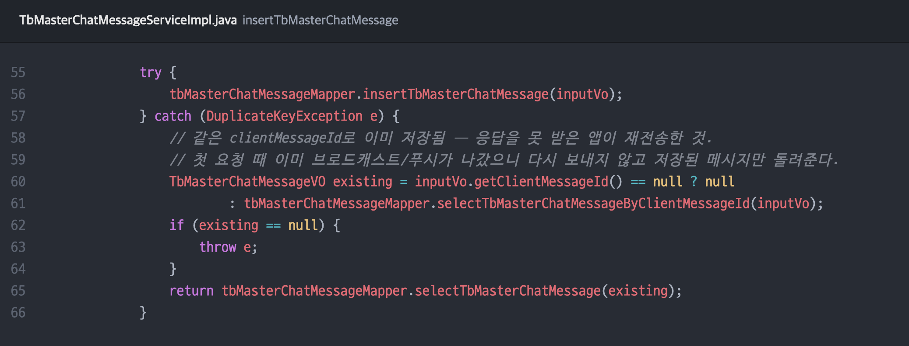
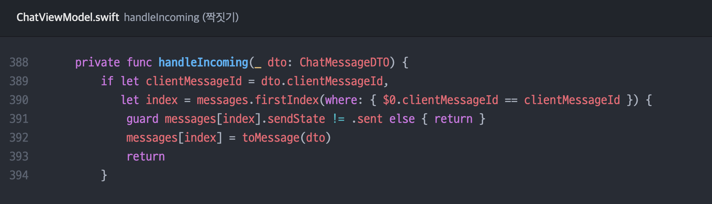
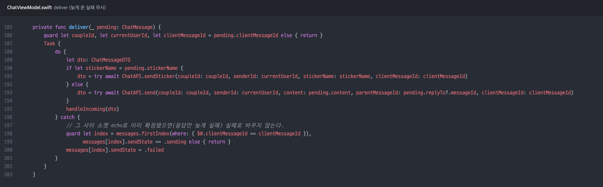
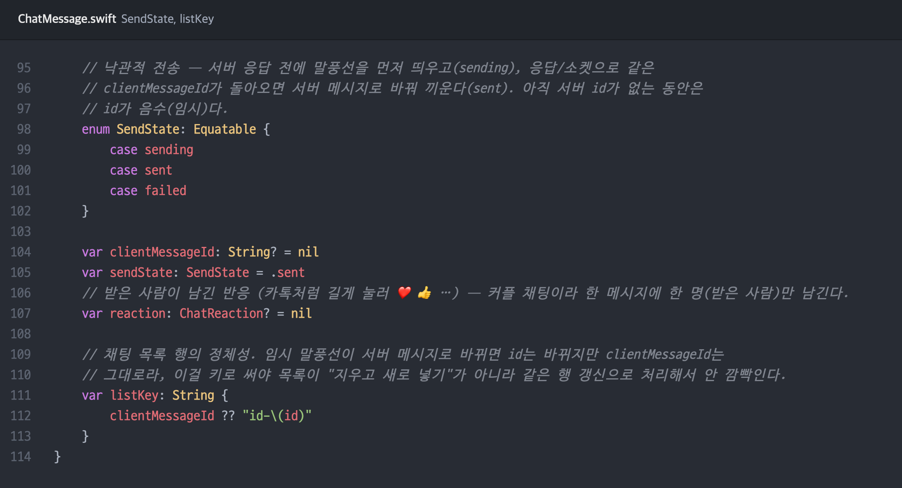

## 개요

- 우린 채팅은 처음에 **서버 응답이 와야** 말풍선을 띄웠다.
  - 와이파이에선 티가 안 나는데, 지하철이나 엘리베이터에서 보내면 말풍선이 한참 뒤에 뜬다.
  - 카카오톡처럼 **누르자마자 말풍선을 띄우고**, 뒤에서 보내도록(낙관적 전송) 바꾸기로 했다.
- 그런데 바꾸려고 보니 질문이 두 개 생겼다.
  - 응답을 못 받았을 때 **다시 보내도 되나?** 사실은 서버에 저장됐는데 응답만 못 받은 거라면 같은 메시지가 두 번 저장된다.
  - 내 메시지가 **REST 응답과 웹소켓으로 두 번** 돌아오는데, 먼저 띄운 말풍선과 어떻게 짝지을까?
- 결과
  - 앱이 보내기 전에 만든 UUID(`clientMessageId`) 하나와 **UNIQUE 인덱스 하나**로 둘 다 해결했다.
  - 같은 값으로 몇 번을 다시 보내도 메시지는 한 번만 저장되고, 서버는 처음 저장된 메시지를 돌려준다.

## 응답을 못 받았다고 실패한 건 아니다

- 앱 입장에서 "전송 실패"는 하나지만, 실제로는 두 경우가 섞여 있다.
  - 요청이 **서버에 닿지 못했다** → 다시 보내야 한다.
  - 서버는 **저장까지 끝냈는데 응답이 돌아오다 끊겼다** → 다시 보내면 안 된다.
- 앱은 이 둘을 구분할 수 없다. 둘 다 타임아웃이나 네트워크 에러로 보인다.
- 그래서 "다시 보내기" 버튼을 만들려면, **같은 요청을 여러 번 보내도 결과가 한 번 보낸 것과 같아야** 한다. (멱등성)
  - 앱이 판단할 수 없으니, 판단은 서버가 해야 한다.
  - 서버가 판단하려면 "이건 아까 그 요청이다"를 알아볼 **식별자**가 요청에 실려 있어야 한다.

## 내 메시지가 두 번 돌아온다

- 우린 채팅은 보내기는 REST, 받기는 웹소켓이다.
  - 서버는 메시지를 저장하면 커플 방에 웹소켓으로 뿌린다. **보낸 사람 본인에게도** 간다.
  - 그래서 내 메시지는 REST 응답과 소켓 echo로 두 번 돌아오고, 순서도 그때그때 다르다.
- 응답을 기다리던 시절엔 서버가 준 `message_id`로 중복을 걸렀다.
- 낙관적 전송에선 말풍선을 띄울 때 **아직 서버 id가 없다.**
  - 임시로 음수 id를 붙여 두지만, 돌아온 메시지의 id와 비교할 수가 없다.
  - 내용으로 비교하면 "ㅋㅋ"를 연달아 두 번 보낼 때 틀린다.
- 결국 여기서도 필요한 건 같다. **앱이 보내기 전에 만들고, 서버가 그대로 돌려주는 식별자.**

## 해결: 앱이 만든 UUID를 UNIQUE로

- 앱은 말풍선을 띄울 때 UUID를 만들어 요청에 싣는다. 다시 보낼 때도 **같은 값**을 쓴다.
- 예전 메시지와 사진 메시지는 이 값이 NULL이다.
  - MySQL UNIQUE는 NULL끼리는 중복으로 보지 않아서, 기존 데이터를 건드리지 않고 인덱스를 걸 수 있었다.

- 왜 "먼저 SELECT로 있는지 보고, 없으면 INSERT"로 안 했나?
  - 재전송은 첫 요청이 아직 처리 중일 때도 온다. 두 요청이 동시에 SELECT하면 **둘 다 "없음"을 보고 둘 다 INSERT**한다.
  - UNIQUE 인덱스에 맡기면 DB가 둘 중 하나만 통과시킨다. 판단을 애플리케이션이 아니라 DB의 제약 조건에 둔 것이다.
- 중복으로 걸린 요청은 **브로드캐스트와 푸시를 다시 하지 않는다.**
  - 첫 요청 때 이미 상대에게 갔다. 여기서 또 보내면 상대는 알림을 두 번 받는다.

## 앱: 돌아온 메시지를 말풍선과 짝짓기

- 말풍선은 세 상태를 가진다. `sending`(시계 아이콘, 흐리게) → `sent`, 또는 `failed`(빨간 느낌표, 다시 보내기/삭제).

- 놓치기 쉬운 순서 문제가 하나 있었다.
  - 소켓 echo가 먼저 와서 `sent`가 됐는데, **REST 응답은 뒤늦게 타임아웃**으로 실패할 수 있다.
  - 그대로 두면 이미 상대에게 간 메시지에 빨간 느낌표가 뜬다.
  - 그래서 실패 처리 전에 "아직 `sending`인가"를 한 번 더 확인한다.

- 채팅 목록을 서버에서 다시 받아올 때도 조심해야 했다.
  - 서버 목록으로 통째로 덮어쓰면, 아직 확인 못 받은(보내는 중/실패) 말풍선이 사라진다.
  - 서버 목록에 같은 `clientMessageId`가 있으면 서버 것을 쓰고, 없으면 뒤에 그대로 붙여 둔다.

## 말풍선이 깜빡였다

- 처음 붙였을 때 보내는 순간 말풍선이 **한 번 깜빡였다.**
- 채팅 목록은 UICollectionView의 diffable data source로 그리는데, 행을 **id**로 구분하고 있었다.
  - 임시 id(-1) → 서버 id(1234)로 바뀌면, diffable은 "-1 행 삭제 + 1234 행 추가"로 본다. 삭제/추가 애니메이션이 깜빡임이었다.
- 행의 키를 `clientMessageId`로 바꿨다. (옛날 메시지는 `"id-<서버 id>"`)
  - 키가 그대로라 "같은 행의 내용만 바뀜"으로 처리되고, 그 셀만 다시 그린다.

## 정리

- 네트워크 요청의 실패는 "안 갔다"와 "갔는데 답을 못 받았다"가 구분되지 않는다. 다시 보내기를 만들려면 **멱등성**이 먼저다.
- 멱등성의 핵심은 **클라이언트가 만든 식별자 + DB의 UNIQUE 제약**이었다.
  - "있는지 보고 넣기"는 동시 요청에 깨진다. 판단은 DB 제약에 맡긴다.
- 같은 식별자가 낙관적 UI의 짝짓기 키, 목록의 행 키까지 한 번에 해결해 줬다.
- [부하 테스트 글](/project/2026/11/23/Woorin-Chat-Load-Test/)의 k6 시나리오에서 메시지마다 `clientMessageId: uuidv4()`를 실어 보낸 이유가 이것이다.

## Reference

<https://developer.mozilla.org/en-US/docs/Glossary/Idempotent>

<https://dev.mysql.com/doc/refman/8.0/en/create-index.html#create-index-unique>

<https://developer.apple.com/documentation/uikit/nsdiffabledatasourcesnapshot/reconfigureitems(_:)>
