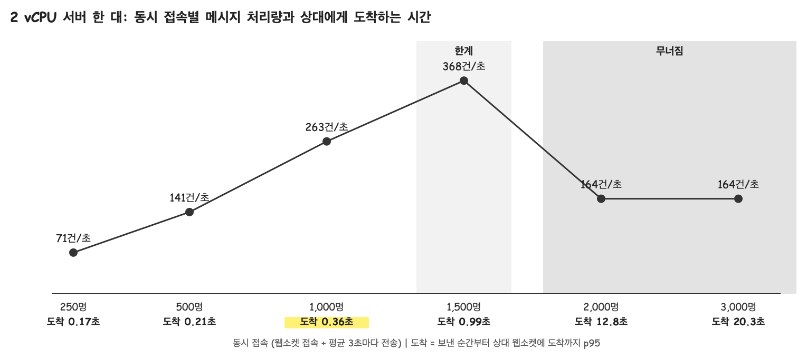
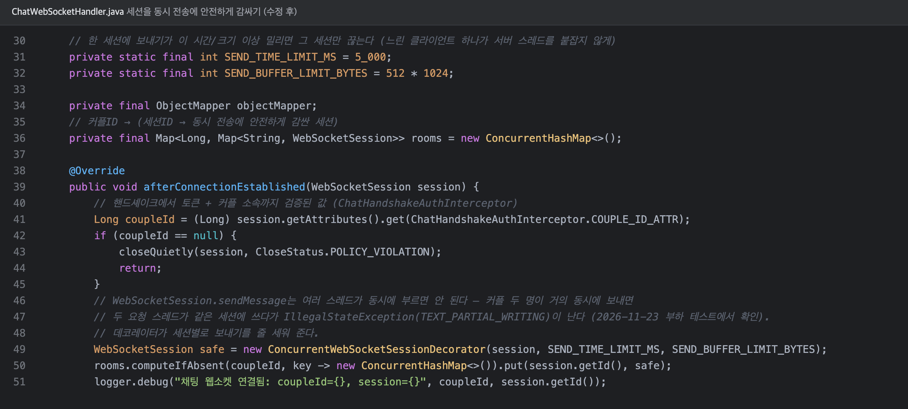
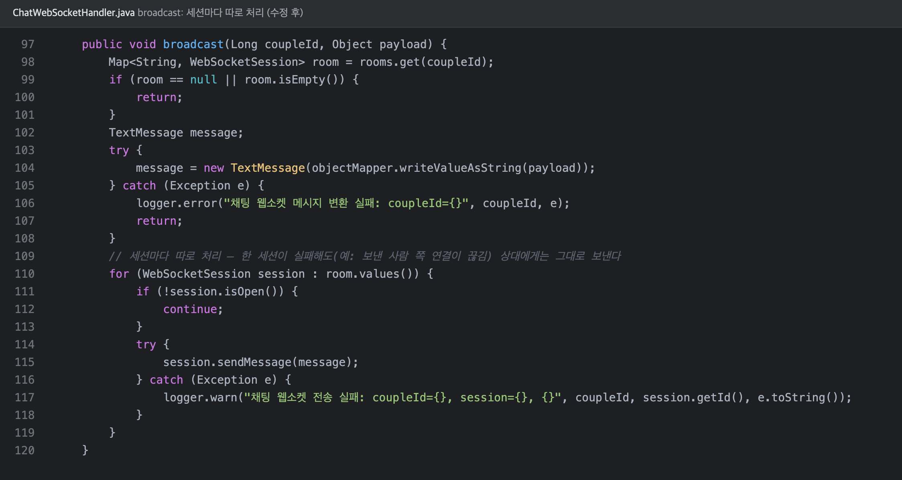
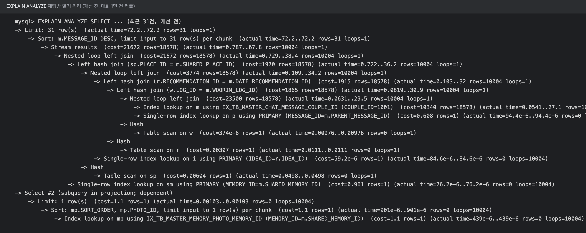
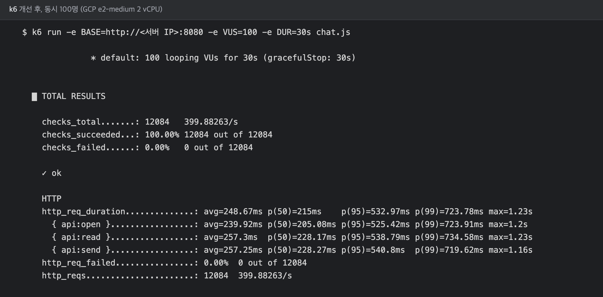

## 개요



- 우린은 여자친구와 둘이 쓰려고 만든 커플 앱이다.
  - 채팅도 직접 만들었는데, 둘이 쓸 때는 메시지가 늦게 간다고 느낀 적이 없다.
  - 그런데 이게 잘 만들어서인지, **둘이라서 티가 안 났던 것**인지는 알 수 없다.
- 그래서 질문을 세웠다.
  - 사람들이 실제로 채팅을 주고받는다면, **이 서버는 몇 명까지 무너지지 않고 버틸까?**
- 결론
  - **1,500명**에서 CPU가 꽉 차고, **2,000명**부터 무너진다. (처리량이 절반 이하로 떨어지고 메시지가 13초 늦게 도착)
  - 1,000명은 측정마다 도착 시간이 0.36~2.8초로 흔들렸다. 여유 있게 쓰려면 1,000명 아래로 잡는 게 안전하다.
  - 부하 속에서 둘이 쓸 땐 안 보이던 **동시성 버그 1개**, 대화가 쌓이면 느려지는 **쿼리 문제 1개**를 찾아서 고쳤다.

## 테스트 환경

- 서버
  - GCP Compute Engine **e2-medium (2 vCPU, 메모리 4GB)**, Ubuntu 24.04, 서울 리전
  - GCP를 고른 이유는 무료 체험 크레딧이다.
  - 서버 한 대에 Spring Boot(Java 17)와 MySQL 8.0을 같이 띄워 운영 중이다.
- 데이터
  - 운영 DB는 건드리지 않고, 같은 MySQL에 **테스트 전용 DB**를 따로 만들었다.
  - 커플 2,500쌍(사용자 5,000명). 서비스 초기처럼 커플마다 대화 50건만 넣었다.
- 부하는 로컬 Mac에서 k6로 원격으로 줬다. (서버까지 왕복 평균 28ms)
- 가상 사용자 한 명 = **실제 사람 한 명처럼** 움직이게 했다.
  - 채팅방에 들어와서(최근 30건 조회) **웹소켓으로 접속해 있는다.**
  - **2~4초(평균 3초)마다** 메시지를 하나 보낸다.
  - 상대가 보낸 메시지는 웹소켓으로 받는다.
- 무엇을 재나
  - **도착 시간**: 보낸 순간부터 상대 웹소켓에 도착할 때까지. 메신저에서 사람이 느끼는 속도다.
  - 보내는 쪽과 받는 쪽이 같은 k6 안에 있어서 시계가 같다. 메시지 내용에 보낸 시각을 넣고, 받는 쪽에서 빼서 잰다.
  - 단계마다 60초 동안 접속을 유지하고, 측정 전마다 테스트 중 생긴 메시지를 지운다.

```javascript
// chat_live.js 일부 — 웹소켓에 붙어 있으면서 평균 3초마다 보내고, 상대 메시지 도착 시간을 잰다
ws.connect(`${WSB}/ws/chat?coupleId=${couple}`, { headers: auth }, function (socket) {
  socket.on('open', function () {
    const loop = function () {
      http.post(`${BASE}/api/chat/messages`, JSON.stringify({ ..., content: `t:${Date.now()}` }), ...);
      socket.setTimeout(loop, 2000 + Math.random() * 2000);
    };
    socket.setTimeout(loop, Math.random() * 3000);
  });
  socket.on('message', function (data) {
    const m = JSON.parse(data);
    if (m.type === 'MESSAGE' && m.message.senderId !== u) {
      delivery.add(Date.now() - Number(m.message.content.slice(2)));   // 도착 시간
    }
  });
});
```

## 몇 명까지 버티나

- 동시 접속을 250명부터 3,000명까지 올렸다.
  - 250명: 초당 71건, 도착 0.17초
  - 500명: 초당 141건, 도착 0.21초
  - **1,000명: 초당 263건, 도착 0.36초** → 원활 (반복 측정에선 1.5~2.8초까지 흔들림, 아래 참고)
  - **1,500명: 초당 368건, 도착 0.99초, CPU 유휴 6%** → 한계
  - **2,000명: 초당 164건, 도착 12.8초** → 무너짐
  - 3,000명: 초당 164건, 도착 20.3초
  - (도착 시간은 p95. 100명 중 95명은 이 시간 안에 받는다는 뜻)
- 2,000명에서 무슨 일이 일어났나?
  - 처리량이 1,500명일 때의 **절반 이하로 떨어졌다.** 사람은 늘었는데 일을 덜 한다. (368 → 164건/초)
  - CPU가 꽉 찬 상태에서 요청이 계속 쌓이면, 서버는 밀린 요청과 웹소켓 전송을 처리하느라 바빠서 새 메시지를 제때 못 받는다.
  - 요청은 결국 다 성공했다(실패율 0%). 하지만 13초 뒤에 도착하는 메시지는 채팅으로 쓸 수 없다. **에러가 안 나도 무너질 수 있다.**

## 부하 속에서 드러난 동시성 버그

- 테스트가 끝나고 서버 로그를 보니 이런 에러가 13건 있었다.
  - `IllegalStateException: The remote endpoint was in state [TEXT_PARTIAL_WRITING]`
- 원인
  - 커플 두 사람이 거의 동시에 메시지를 보내면, 두 요청 스레드가 **같은 웹소켓 세션**에 동시에 메시지를 쓴다.
  - Spring의 `WebSocketSession.sendMessage`는 여러 스레드가 동시에 부르면 안 된다. 한 쪽이 쓰는 중에 다른 쪽이 쓰려다 터진다.
  - 둘이 쓸 땐 두 사람이 같은 밀리초에 보낼 일이 거의 없어서 보이지 않았다.
- 같이 찾은 문제
  - broadcast의 try-catch가 반복문 **바깥**에 있었다.
  - 한 세션에서 전송이 실패하면(예: 보낸 사람 쪽 연결이 끊김) 반복이 멈춰서, **같은 방의 상대도 메시지를 못 받는다.**





- 고친 것
  - 세션을 `ConcurrentWebSocketSessionDecorator`로 감싼다. 세션마다 보내기를 줄 세워 준다.
  - 한 세션에 보내기가 5초 또는 512KB 이상 밀리면 그 세션만 끊는다. 느린 클라이언트 하나가 서버 스레드를 붙잡지 않게.
  - 실패 처리를 세션마다 따로 한다. 한 명이 실패해도 상대에게는 보낸다.
- 결과
  - 같은 테스트에서 `TEXT_PARTIAL_WRITING` **13건 → 0건**.
  - 버티는 인원은 그대로였다. (1,500명 포화, 2,000명 붕괴) 버그는 정확성 문제였고, 한계는 CPU였다.

## 몇 달 쓰면? 대화가 쌓이면 생기는 문제

- 위 테스트는 서비스 초기처럼 대화가 적은 상태였다.
- 몇 달 쓴 커플이라면 대화가 1만 건씩 쌓인다. 그래서 커플 100쌍에 대화 1만 건씩(총 100만 건) 넣고, 100명이 쉬지 않고 채팅방 열기, 보내기, 읽음 처리를 반복하게 했다.


- **19.9 TPS, p95 10.64초.** 메시지 하나 보내는 데 평균 5초다.


- MySQL에서 쿼리별로 30초 동안 쓴 시간을 집계했다. (performance_schema)
  - **채팅방 열기 (최근 30건)**: 평균 664ms, 압도적 1위
  - **읽음 처리 UPDATE**: 평균 348ms
  - 둘 다 **커플의 대화 기록 전체를 훑는** 쿼리였다.



- 채팅방 열기 실행계획 (LIMIT 31로 떴다)
  - `Index lookup on m ... rows=10004` → 이 커플의 메시지를 **전부** 읽는다.
  - `loops=10004` → 6개 테이블 조인과 사진 서브쿼리를 **1만 번씩** 한다.
  - `Sort: ... limit input to 31 row(s)` → 그 다음에야 31건만 남긴다.
  - 조인 때문에 "최근 N건만"이 **맨 마지막에** 걸려서, 대화가 쌓일수록 그만큼 느려진다.


- 개선 1: (커플, 메시지ID) 인덱스로 **최근 N건의 ID만 먼저** 뽑고, 그 N건에만 조인한다.
  - 쿼리 하나만 실행하면 **72.2ms → 1.28ms**.
  - 바꾸기 전과 후 API 응답(최근 30건, 이전 페이지)을 해시로 비교해서 **결과가 같은지** 확인했다.
- 개선 2: (커플, 읽음 여부, 보낸 사람) 인덱스
  - `=` 조건(COUPLE_ID, READ_YN)을 앞에, `!=` 조건(SENDER_ID)을 뒤에 둬서 "이 커플의 안 읽은 메시지"까지 인덱스로 바로 좁힌다.
  - 읽음 처리 UPDATE 평균 **348ms → 13ms**.

```sql
CREATE INDEX IX_TB_MASTER_CHAT_MESSAGE_UNREAD
    ON TB_MASTER_CHAT_MESSAGE (COUPLE_ID, READ_YN, SENDER_ID);
```



- 결과: **19.9 TPS → 399.9 TPS (약 20배), p95 10.64초 → 0.53초**
- 위의 동시 접속 테스트는 이 개선을 적용한 상태에서 잰 것이다.

## 측정하며 틀렸던 것

- 처음엔 "몇 명까지"가 아니라 "대화가 쌓인 상태"를 재고 있었다.
  - 대화를 미리 넣은 순간 사람 수와 데이터 양, 두 변수가 섞였다. 원래 질문에 답하려고 대화가 적은 상태에서 사람만 늘리는 테스트를 따로 했다.
- 가상 사용자 100명은 사람 100명이 아니다.
  - k6 가상 사용자는 쉬지 않고 요청을 보낸다. 사람은 메시지 하나 쓰는 데 몇 초가 걸린다. 그래서 사람처럼 3초마다 보내게 바꿨다.
- 데이터가 쌓이는 걸 몰랐다.
  - 측정을 연달아 돌리면 메시지가 쌓여서 뒤에 잰 쪽이 불리하다. → 측정 전마다 지웠다.
- 서버를 띄우자마자 쟀다.
  - 개선 후 첫 측정이 178 TPS로 나왔는데, 워밍업 후엔 400 TPS였다. Java는 처음 실행될 때 코드를 최적화(JIT)하는 시간이 있다.
- 커넥션 풀이 원인일 거라고 짐작했다.
  - 기본값 8개라 의심했지만, 로컬에서 30개로 늘리니 **오히려 느려졌다.** (TPS 1,421 → 1,028) 연결이 많아지면 DB 안에서 쿼리끼리 경합한다.
- 같은 조건인데 숫자가 흔들렸다.
  - 1,000명 도착 시간이 측정마다 0.36초, 1.5초, 2.8초로 달랐다. 테스트를 오래 돌린 뒤일수록 느렸다. (CPU steal 0%, IO 대기 8%) 원인은 아직 확정 못 했다.
  - 반면 1,500명 포화, 2,000명 붕괴는 매번 같았다. 그래서 "몇 명까지"는 이 두 지점을 기준으로 본다.

## 한계를 넘으려면

- 1,500명에서 CPU가 꽉 찼다. 앞선 쿼리 테스트에서 CPU가 꽉 찼을 때를 보면, 그중 1/3 이상을 같은 서버의 MySQL이 쓰고 있었다. (Java 121% + MySQL 72%)
- 순서대로 하면
  - 먼저 **Java와 MySQL을 분리**한다. (Cloud SQL 같은 관리형 DB)
  - 그래도 부족하면 **서버를 여러 대로 늘린다.** 그런데 지금 코드는 그대로 늘릴 수 없다.


- 웹소켓 방 목록이 **서버 메모리**에 있다.
  - 커플 두 사람이 서로 다른 서버에 붙으면, A 서버의 rooms에는 상대가 없다. → 실시간 메시지가 안 간다.
  - 방법 1: 메시지를 저장한 서버가 **Redis Pub/Sub**으로 발행하고, 모든 서버가 구독해서 자기한테 붙은 사람에게만 보낸다.
  - 방법 2: 로드밸런서에서 **같은 커플은 같은 서버로** 보낸다. 간단하지만 서버 하나가 죽으면 그 커플들이 다 끊긴다.


- 데이트 추천 중복 방지가 **JVM 안의 synchronized**다.
  - 같은 서버 안의 스레드끼리만 막아준다. 만들 때 "단일 인스턴스 전제"라고 주석으로 남겨뒀다.
  - 늘리면 MySQL `GET_LOCK` 같은 DB 락이나 Redis 락으로 바꿔야 한다.
- 그 밖에
  - 사진을 서버 디스크에 저장한다. → 공용 저장소(GCS 같은)가 필요하다.
  - 푸시 대기열이 메모리(@Async)에 있다. → 서버가 죽으면 보내지 못한 알림이 사라진다.

## 정리

- 2 vCPU 서버 한 대로 **1,500명**까지 버티고, **2,000명**부터 무너진다. 여유 있게는 1,000명 아래다.
- 둘이 쓸 땐 안 보이던 문제는 **사람과 데이터가 늘어야** 드러난다.
  - 사람이 늘자 동시성 버그가, 데이터가 쌓이자 느린 쿼리가 보였다.
- 에러가 안 나도 무너질 수 있다. 실패율이 아니라 **도착 시간과 처리량**을 봐야 한다.
- 다음에 할 것
  - Java와 MySQL을 분리하고 다시 재본다. 그다음 웹소켓을 Redis Pub/Sub으로 바꿔 서버 두 대로 늘려 본다.

## Reference

<https://grafana.com/docs/k6/latest/javascript-api/k6-ws/>

<https://docs.spring.io/spring-framework/reference/web/websocket/server.html>

<https://dev.mysql.com/doc/refman/8.0/en/explain.html#explain-analyze>
