## 개요

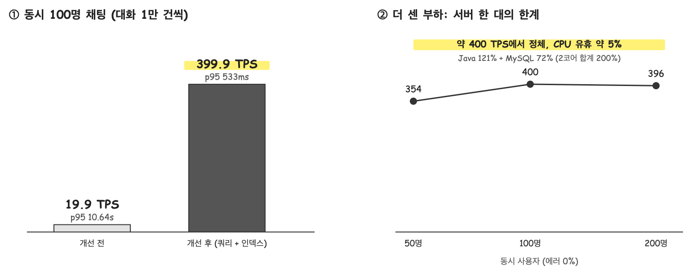

- 우린은 여자친구와 둘이 쓰려고 만든 커플 앱이다.
  - 채팅도 직접 만들었는데, 둘이 쓸 때는 메시지가 늦게 간다고 느낀 적이 없다.
  - 그런데 이게 잘 만들어서인지, **둘이라서 티가 안 났던 것**인지는 알 수 없다.
- 그래서 질문을 하나 세웠다.
  - **100명이 동시에 채팅을 쓴다면** 지금 로직이 버틸까?
  - 문제가 있다면 어느 로직이고, 어떻게 고칠 수 있을까?
- 결과
  - 동시 100명에서 **19.9 TPS, p95 10.64초** → 쿼리 1개 수정 + 인덱스 1개 추가로 **399.9 TPS, p95 0.53초** (약 20배)
  - 그 뒤엔 약 400 TPS에서 멈췄다. 쿼리가 아니라 **서버 한 대(2 vCPU)의 한계**였다.

## 테스트 환경

- 서버
  - GCP Compute Engine **e2-medium (2 vCPU, 메모리 4GB)**, Ubuntu 24.04, 서울 리전
  - GCP를 고른 이유는 무료 체험 크레딧이다.
  - 서버 한 대에 Spring Boot(Java 17)와 MySQL 8.0을 같이 띄워 운영 중이다.
  - 커넥션 풀은 따로 설정하지 않아 DBCP2 기본값(최대 8개)이다.
- 데이터
  - 운영 DB는 건드리지 않고, 같은 MySQL에 **테스트 전용 DB**를 따로 만들었다.
  - 커플 100쌍(사용자 200명), 커플마다 대화 약 1만 건, **총 100만 건**.
  - 둘이 쓸 때 대화는 수백 건이었다. 몇 달 쓴 커플처럼 대화를 쌓아야 문제가 보일 거라고 봤다.
- 부하 도구는 k6를 썼다.
  - 시나리오를 JavaScript로 짤 수 있어서, 실제 채팅처럼 "열고, 보내고, 읽는" 흐름을 섞기 쉽다.
  - 부하는 로컬 Mac에서 원격으로 줬다. 서버와 부하 도구가 같은 기계에 있으면 CPU를 나눠 써서 숫자가 흔들린다. (처음에 로컬에서 다 같이 돌렸다가 숫자가 크게 흔들려서 바꿨다)

```javascript
// chat.js — 가상 사용자 한 명 = 커플 중 한 사람
export default function () {
  const r = Math.random();
  if (r < 0.5) {        // 50% 채팅방 열기 (최근 30건)
    http.get(`${BASE}/api/chat/messages?coupleId=${couple}&limit=30`, ...);
  } else if (r < 0.9) { // 40% 메시지 보내기 (재전송 대비 전송 ID 포함)
    http.post(`${BASE}/api/chat/messages`, JSON.stringify({ coupleId, senderId, content, clientMessageId: uuidv4() }), ...);
  } else {              // 10% 읽음 처리
    http.post(`${BASE}/api/chat/read?coupleId=${couple}&readerId=${u}`, ...);
  }
}
```

- 측정 규칙
  - 동시 사용자 N명이 쉬지 않고 30초 동안 반복한다.
  - 측정 전에 **테스트 중 생긴 메시지를 지운다.** 안 지우면 측정할수록 데이터가 쌓여서 뒤 측정이 불리해진다.
  - 서버를 띄운 직후가 아니라 **워밍업한 뒤** 잰다. (이유는 아래 "측정하며 틀렸던 것")

## 100명이면 10초가 걸렸다

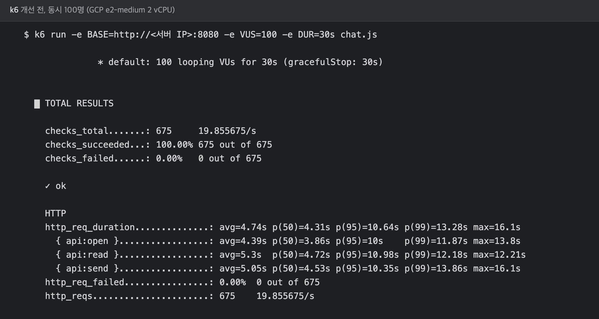

- 동시 100명에서 **19.9 TPS, p95 10.64초**. 에러는 없었지만 메시지 하나 보내는 데 평균 5초다.
- 채팅방 열기, 보내기, 읽음 처리가 모두 비슷하게 느렸다.
  - 하나가 느리면 그 요청이 커넥션과 CPU를 붙잡고 있어서, 나머지도 같이 줄을 선다.
- 그래서 DB에서 어떤 쿼리가 시간을 쓰고 있는지부터 봤다.

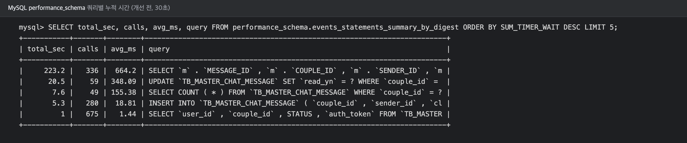

```sql
-- 쿼리별로 30초 동안 DB 시간을 얼마나 썼는지 (측정 전에 TRUNCATE로 비운다)
SELECT ROUND(SUM_TIMER_WAIT/1e12,1) AS total_sec, COUNT_STAR AS calls,
       ROUND(AVG_TIMER_WAIT/1e9,2) AS avg_ms, DIGEST_TEXT
  FROM performance_schema.events_statements_summary_by_digest
 ORDER BY SUM_TIMER_WAIT DESC LIMIT 5;
```

- 결과
  - **채팅방 열기 (최근 30건)**: 평균 664ms, 30초 동안 223초. 압도적 1위다.
  - **읽음 처리 UPDATE**: 평균 348ms
  - **안 읽은 수 COUNT**: 평균 155ms
- 셋 다 **커플의 대화 기록 전체를 훑는** 쿼리였다.

## 원인: 최근 30건을 보여주려고 1만 건을 읽고 있었다

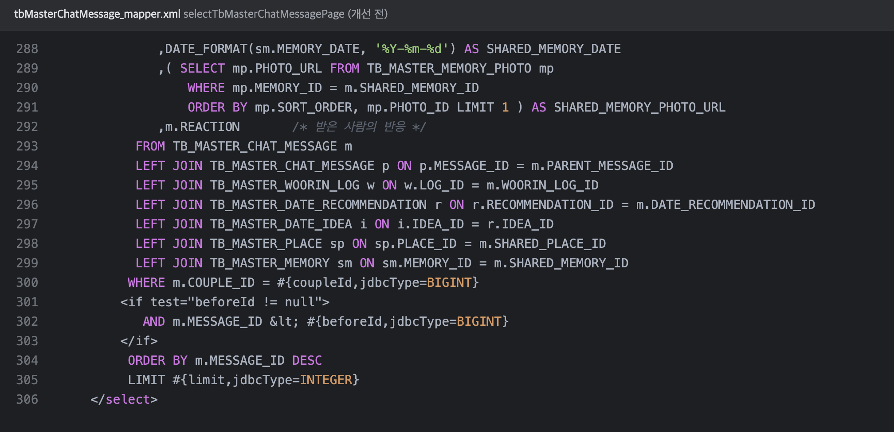

- 코드만 보면 문제없어 보인다. 앱이 `limit=30`을 보내면 `ORDER BY ... LIMIT`으로 최근 30건만 가져온다.
  - 아래 실행계획은 같은 쿼리를 LIMIT 31로 떠서 31건으로 나온다.


- 실행계획(EXPLAIN ANALYZE)을 아래에서 위로 읽으면 실제 순서가 보인다.
  - `Index lookup on m ... rows=10004` → 이 커플의 메시지를 **전부** 읽는다.
  - `Single-row index lookup on p ... loops=10004` → 답장 대상, 공유 장소, 추억 등 6개 테이블 조인을 **1만 번씩** 한다.
  - `Select #2 (dependent) ... loops=10004` → 메시지마다 사진 서브쿼리를 **1만 번** 돈다.
  - `Sort: ... limit input to 31 row(s)` → 그 다음에야 정렬해서 **31건만** 남긴다. (앱 요청이면 30건)
- 왜 이렇게 되나?
  - LEFT JOIN과 SELECT 절의 서브쿼리가 붙어 있으면, MySQL은 조인을 다 끝낸 결과에 정렬과 LIMIT을 건다.
  - 즉 "최근 30건만"이라는 조건이 **맨 마지막에** 걸린다.
  - 그래서 대화가 쌓일수록 채팅방 열기가 그만큼 느려진다. 둘이 쓸 때처럼 대화가 수백 건이면 금방 끝나서, 몰랐던 이유가 이거다.

## 개선 1. 최근 N건의 ID만 먼저 뽑기

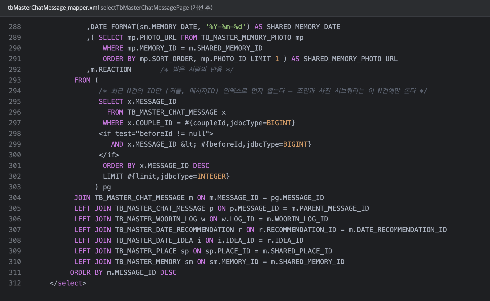

- 순서를 바꿨다.
  - 먼저 (커플, 메시지ID) 인덱스만으로 **최근 N건의 ID**를 뽑는다. 이 단계는 인덱스만 보고 N개에서 멈춘다.
  - 그 N건에만 메시지 본문, 조인, 사진 서브쿼리를 붙인다.
- 조인할 대상이 1만 건에서 30건으로 줄어드니, 대화가 아무리 쌓여도 비용이 일정하다.

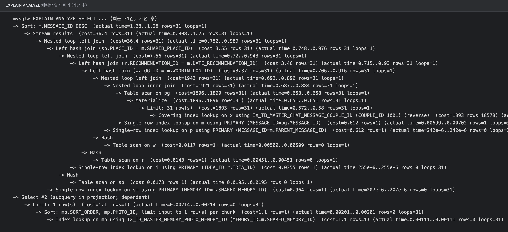

- 실행계획
  - `Limit: 31 row(s)` → `Materialize rows=31` → 31건을 먼저 만들고 나서 조인한다.
  - 쿼리 하나만 실행하면 **72.2ms → 1.28ms**.
- 결과가 같은가?
  - 쿼리를 바꾸면 순서나 빠지는 데이터가 생길 수 있다.
  - 바꾸기 전과 후 서버에서 같은 API(최근 30건, 이전 페이지)를 호출해 **응답 JSON을 해시로 비교**했다. 둘 다 같았다.

## 개선 2. 안 읽은 메시지만 바로 찾는 인덱스

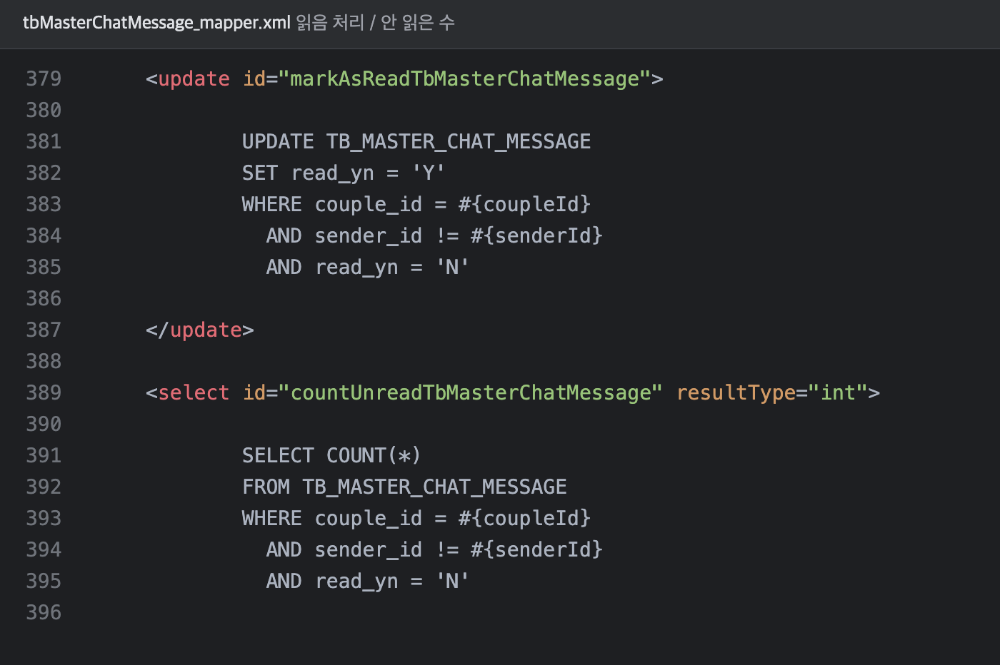

- 읽음 처리와 안 읽은 수 세기는 같은 걸 찾는다.
  - "이 커플에서(`couple_id =`), **안 읽은(`read_yn = 'N'`)**, 상대가 보낸(`sender_id !=`) 메시지"
  - 기존엔 (커플, 시간) 인덱스뿐이라, 커플의 메시지를 전부 꺼내 하나씩 읽음 여부를 확인했다.
- 안 읽은 수는 푸시를 보낼 때 배지 숫자로 쓴다.
  - 푸시는 응답이 늦어지지 않도록 `@Async`로 별도 스레드에서 보낸다.
  - 그런데 **DB는 같이 쓴다.** 응답 시간에는 안 보여도, 이 쿼리가 DB를 붙잡고 있어서 결국 전체가 느려진다.

```sql
CREATE INDEX IX_TB_MASTER_CHAT_MESSAGE_UNREAD
    ON TB_MASTER_CHAT_MESSAGE (COUPLE_ID, READ_YN, SENDER_ID);
```

- 컬럼 순서를 이렇게 둔 이유
  - `=`로 찾는 컬럼(COUPLE_ID, READ_YN)을 앞에, `!=`로 거르는 SENDER_ID를 뒤에 뒀다.
  - 그러면 "이 커플의 안 읽은 메시지"까지 인덱스로 바로 좁혀진다. 대부분 읽은 상태라 안 읽은 건 몇 건 안 된다.
  - COUNT는 이 인덱스만 보고 끝난다. (실행계획에 `Covering index range scan`)
- 결과: 읽음 처리 UPDATE 평균 **348ms → 13ms**, 안 읽은 수 COUNT는 상위 쿼리 목록에서 사라졌다.

## 결과


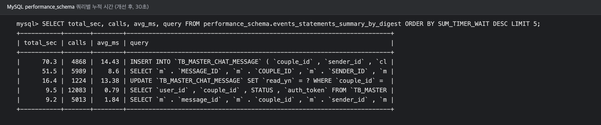

- 동시 100명, 같은 서버, 같은 데이터
  - 개선 전: **19.9 TPS, p95 10.64초**
  - 개선 후: **399.9 TPS, p95 0.53초** (약 20배)
- 이제 DB 시간 1위는 메시지 INSERT(평균 14ms)다. 남은 건 **정상적인 쓰기 비용**이다.

## 측정하며 틀렸던 것

- 데이터가 쌓이는 걸 몰랐다.
  - 처음엔 측정을 연달아 돌렸다. 메시지 보내기가 40%라 측정마다 수만 건씩 쌓여서, 뒤에 잰 쪽이 항상 불리했다.
  - → 측정 전마다 테스트 중 생긴 메시지를 지우도록 바꿨다.
- 서버를 띄우자마자 쟀다.
  - 개선 후 첫 측정이 178 TPS로 나왔는데, 워밍업 후 다시 재니 400 TPS였다.
  - Java는 처음 실행될 때 코드를 최적화(JIT)하는 시간이 있어서, 띄운 직후 숫자는 낮게 나온다.
  - → 짧게 부하를 준 뒤 측정했다. 개선 전도 같은 방식으로 다시 쟀다. (개선 전은 DB가 병목이라 차이가 거의 없었다)
- 커넥션 풀이 원인일 거라고 짐작했다.
  - 처음 느렸을 때 가장 먼저 의심한 건 커넥션 풀(기본 8개)이었다.
  - 로컬에서 30개로 늘려 봤더니 **오히려 느려졌다.** (100명, TPS 1,421 → 1,028)
  - 연결이 많아지면 DB 안에서 동시에 도는 쿼리가 늘어 서로 경합한다. 풀 크기는 늘릴수록 좋은 값이 아니라, DB가 감당할 수 있는 만큼으로 맞추는 값이다.
  - 진짜 원인은 쿼리별 누적 시간을 보고 나서야 찾았다.

## 더 센 부하: 이번엔 서버 한 대의 한계

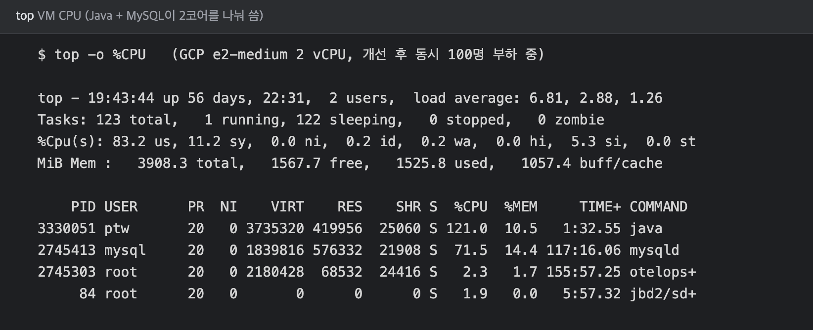

- 동시 사용자를 올려 봤다.
  - 50명 354 TPS / 100명 400 TPS / 200명 396 TPS. 에러는 0%.
  - 약 **400 TPS에서 멈추고**, 응답시간만 늘었다. (200명 p95 1.21초)
- 어디가 막혔나?
  - CPU 유휴가 약 5%. **Java 121% + MySQL 72%**로 2코어(200%)를 둘이 나눠 쓰며 꽉 찼다.
  - 쿼리는 이미 가볍다. 이제는 특정 쿼리가 아니라 **서버 한 대가 한계**다.
- 그럼 무엇을 해야 하나? 순서대로 보면
  - 먼저 같은 서버에 있는 **Java와 MySQL을 분리**한다. (Cloud SQL 같은 관리형 DB) 지금 CPU의 1/3 이상을 MySQL이 쓰고 있다.
  - 그래도 부족하면 **서버를 여러 대로 늘린다.** 그런데 지금 코드는 그대로 늘릴 수 없다.

## 서버를 늘리려면 바꿔야 하는 것

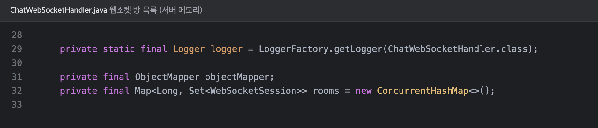

- 웹소켓 방 목록이 **서버 메모리**에 있다.
  - 커플 두 사람이 서로 다른 서버에 붙으면, A 서버의 rooms에는 B 서버에 붙은 상대가 없다. → 실시간 메시지가 상대에게 안 간다.
  - 방법 1: 메시지를 저장한 서버가 **Redis Pub/Sub**으로 "커플 N에 메시지"를 발행하고, 모든 서버가 구독해서 자기한테 붙은 사람에게만 보낸다.
  - 방법 2: 로드밸런서에서 **같은 커플은 같은 서버로** 보낸다. 간단하지만 서버가 하나 죽으면 그 커플들이 다 끊긴다.

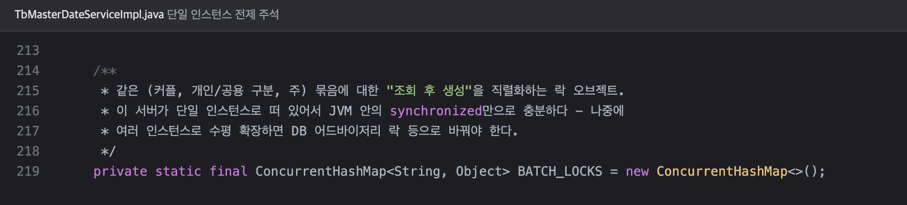

- 데이트 추천 중복 방지가 **JVM 안의 synchronized**다.
  - 같은 서버 안의 스레드끼리만 막아준다. 서버가 두 대면 두 요청이 각자 다른 서버에서 동시에 통과한다.
  - 만들 때 이미 "단일 인스턴스 전제"라고 주석으로 남겨뒀다. 늘리면 MySQL `GET_LOCK` 같은 DB 락이나 Redis 락으로 바꿔야 한다.
- 그 밖에
  - 사진을 서버 디스크에 저장한다. → 서버마다 디스크가 달라지니 공용 저장소(GCS 같은)가 필요하다.
  - 푸시 대기열이 메모리(@Async)에 있다. → 서버가 죽으면 보내지 못한 알림이 사라진다. 메시지 큐로 옮기는 걸 고려해야 한다.

## 정리

- 둘이 쓸 땐 안 보이던 문제는 **데이터와 사용자가 늘어야** 드러난다.
- 짐작보다 측정이 원인을 가리킨다.
  - 커넥션 풀을 의심했지만, 쿼리별 누적 시간과 실행계획이 정확히 어디가 문제인지 보여줬다.
- 숫자는 측정 방법에 따라 쉽게 틀린다. 데이터 초기화, 워밍업, 부하 도구 분리를 지켜야 비교할 수 있다.
- 병목은 사라지지 않고 **다음 자리로 옮겨 간다.** DB → 서버 CPU → 서버 한 대.
- 다음에 할 것
  - Java와 MySQL 분리, 웹소켓 메시지를 Redis Pub/Sub으로 서버 간에 공유하도록 바꾸고, 서버를 두 대로 늘려 다시 재본다.

## Reference

<https://grafana.com/docs/k6/latest/>

<https://dev.mysql.com/doc/refman/8.0/en/explain.html#explain-analyze>

<https://dev.mysql.com/doc/refman/8.0/en/performance-schema-statement-digests.html>
