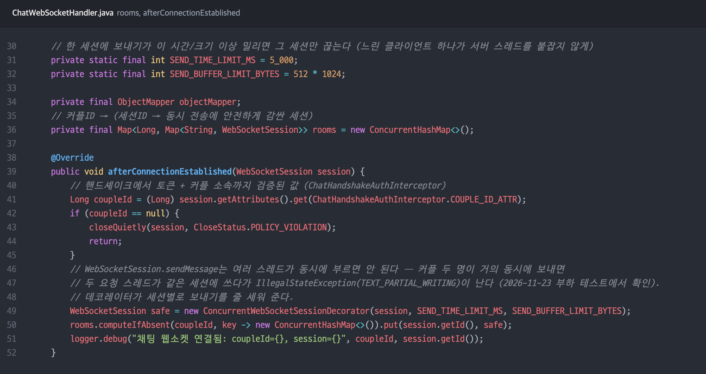
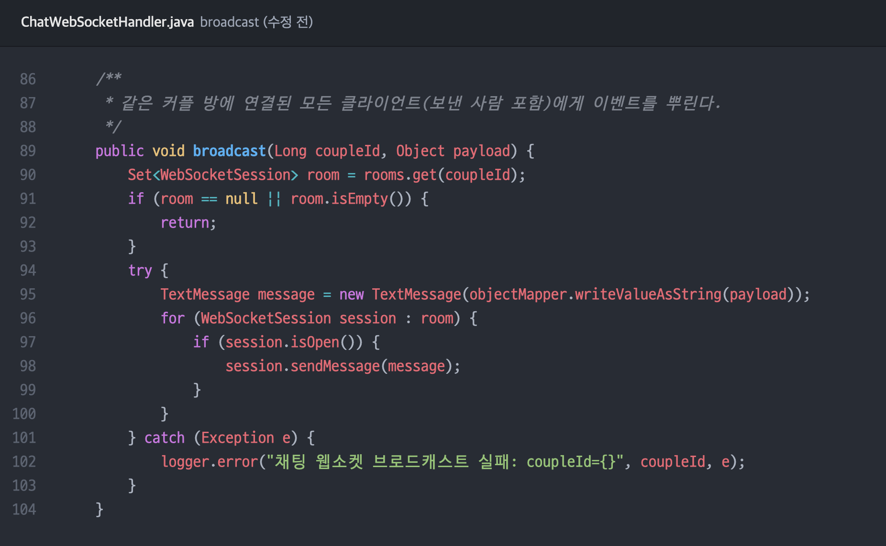
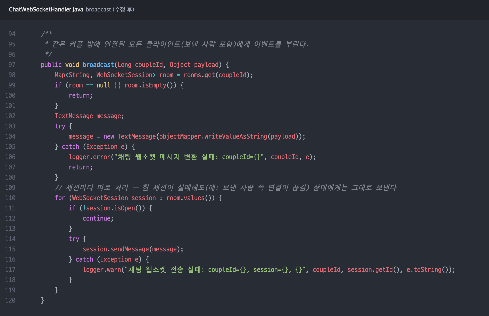
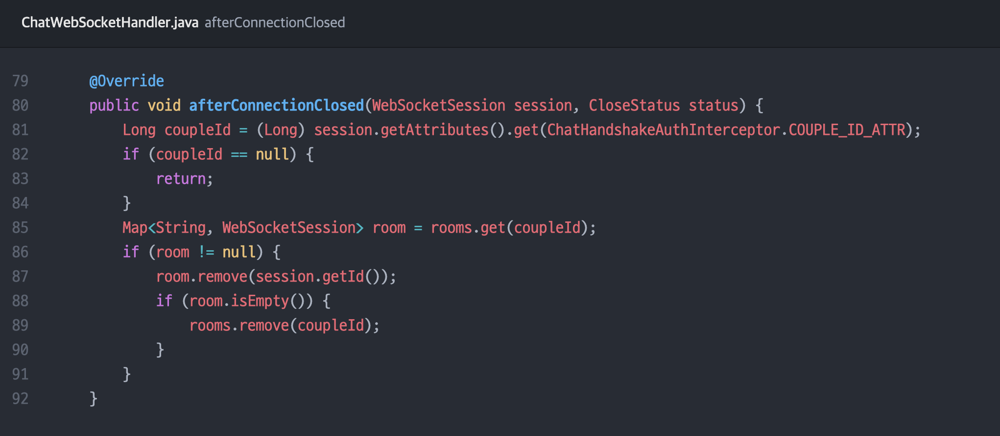
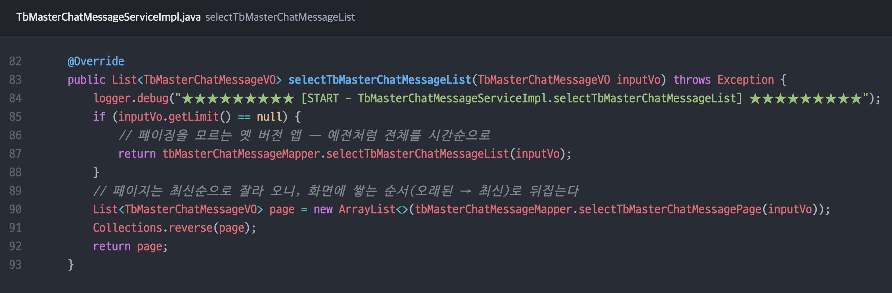
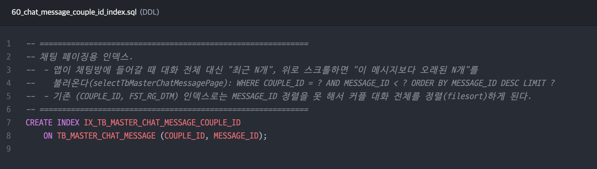

## 개요

- 우린 채팅의 실시간 전송은 Spring의 `TextWebSocketHandler` 하나로 돌아간다.
- 처음엔 단순했다. 커플별로 연결된 세션을 모아 두고, 메시지가 저장되면 그 세션들에 뿌린다.
- 그런데 쓰다 보니, 그리고 [부하 테스트](/project/2026/11/23/Woorin-Chat-Load-Test/)를 하다 보니 서버 쪽에서 네 가지 문제가 나왔다.
  - 세션 **하나**에서 전송이 실패하면 같은 방의 **상대도** 못 받았다.
  - 둘이 거의 동시에 보내면 전송 자체가 **예외로 깨졌다.**
  - 조용히 끊긴 연결은 서버도 **끊긴 줄 모른다.**
  - 끊겨 있던 동안의 메시지는 웹소켓으로는 **다시 오지 않는다.**

## 구조: 보내기는 REST, 받기는 웹소켓

- 앱이 메시지를 보낼 때는 웹소켓이 아니라 **REST**(`POST /api/chat/messages`)를 쓴다.
- 웹소켓은 서버 → 앱 방향으로 **결과를 알려주는 용도**다.
  - `MESSAGE`(새 메시지), `READ`(읽음), `REACTION`(반응), `WOORIN_LOG`(우린로그 올림/삭제)
- 앱이 웹소켓으로 보내는 건 "입력 중(`TYPING`)" 하나뿐이다. REST로 보내기엔 너무 잦고 가볍기 때문이다.
- 왜 보내기를 REST로 했나?
  - 인증, 입력 검증, 에러 응답, [재전송 중복 방지](/project/2026/11/23/Woorin-Chat-Idempotency/)를 이미 있는 REST 구조 그대로 쓸 수 있다.
  - 웹소켓으로 받으면 이걸 다 소켓 메시지 위에서 다시 만들어야 한다.
  - 저장이 성공했는지를 앱이 **응답 코드로** 바로 안다.

### 커플 = 방

- 커플은 항상 두 명뿐이라, 채팅방 테이블을 따로 두지 않고 `COUPLE_ID`를 그대로 방으로 쓴다.
- 서버는 메모리에 "커플 → 그 커플에 연결된 세션들"을 들고 있다.



- 한 커플에 세션이 둘보다 많을 수 있다. 한 사람이 폰과 다른 기기로 동시에 붙거나, 재연결하면서 잠깐 옛 세션과 새 세션이 겹칠 때다.
- 세션은 핸드셰이크에서 검증된 `coupleId`로만 방에 들어간다. ([웹소켓 인증](/project/2026/11/23/Woorin-WebSocket-Auth/))

## 1. 세션 하나가 실패하면 상대도 못 받았다

- 처음 `broadcast`는 이랬다.



- `try`가 **반복문 바깥**에 있다.
  - 방에 세션이 둘(나, 상대) 있을 때, 내 세션이 먼저 돌았는데 내 연결이 막 끊긴 상태라 `sendMessage`가 예외를 던지면
  - 반복문이 거기서 끝나고 **상대 세션에는 보내지도 않는다.**
- 메시지 저장은 성공했고, 에러 로그도 남는다. 그런데 상대 화면에는 메시지가 안 뜬다.
  - 로그만 보면 "보낸 사람 쪽 연결이 끊겼다"로 읽혀서, 상대가 못 받았다는 게 바로 드러나지 않는다.
- 세션마다 따로 처리하도록 바꿨다.



- JSON 변환은 세션과 상관없으니 반복문 **밖**에서 한 번만 하고, 실패하면 그때는 아무에게도 안 보낸다.
- 전송은 세션마다 `try`를 따로 걸어서, 한 세션의 실패가 다른 세션에 번지지 않게 했다.

## 2. 둘이 동시에 보내면 전송이 깨졌다

- 부하 테스트에서 이런 예외가 나왔다.

```
java.lang.IllegalStateException: The remote endpoint was in state [TEXT_PARTIAL_WRITING]
which is an invalid state for called method
```

- 원인은 `WebSocketSession.sendMessage`가 **스레드 안전하지 않은 것**이다.
  - 메시지 전송은 REST 요청이라, 요청마다 다른 톰캣 스레드에서 `broadcast`가 돈다.
  - 커플 두 사람이 거의 동시에 보내면, 두 스레드가 **같은 세션에 동시에** 쓰려고 한다. 한쪽이 쓰는 중에 다른 쪽이 끼어들면 위 예외가 난다.
  - 새 메시지와 읽음 이벤트가 겹쳐도 똑같다. 둘이 쓸 땐 동시에 보낼 일이 드물어서 몰랐다.
- Spring이 제공하는 `ConcurrentWebSocketSessionDecorator`로 세션을 감쌌다.


- 데코레이터는 같은 세션으로 가는 전송을 **줄 세워서** 한 번에 하나씩 보낸다. 다른 스레드가 쓰는 중이면 버퍼에 넣고 돌아간다.
- 두 가지 한도를 줬다.
  - **5초** 넘게 한 세션의 전송이 밀리거나, **512KB** 넘게 쌓이면 그 세션만 끊는다.
  - 느린(또는 반쯤 죽은) 클라이언트 하나 때문에 요청 스레드가 붙잡혀 있지 않게 하려는 것이다.
- 방 안의 세션 저장 방식도 같이 바꿨다.
  - 예전엔 `Set<WebSocketSession>`에 세션을 그대로 넣었다.
  - 이제 방에 넣는 건 **데코레이터로 감싼 세션**인데, 연결이 끊길 때 Spring이 넘겨주는 건 **원래 세션**이다. 둘은 서로 다른 객체라 `Set`에서 지울 수가 없다.
  - 그래서 세션 ID를 키로 하는 `Map`으로 바꿨다. 감싼 세션이든 원래 세션이든 ID는 같다.



## 3. 끊긴 세션은 서버도 모른다

- 모바일 셀룰러망이나 공유기(NAT)는 한동안 아무것도 안 오가는 연결을 **양쪽에 알리지 않고** 정리해 버리는 경우가 많다.
  - 연결을 끊을 때 보내는 신호가 없으니, 서버 입장에서 그 세션은 여전히 "열림"이다.
  - `afterConnectionClosed`가 불리지 않으니 방에서도 안 빠진다. 서버는 계속 그 세션에 메시지를 보낸다.
- 이 상태에서 서버가 할 수 있는 건 **잘못 보내도 피해가 번지지 않게** 하는 것이다.
  - 1번처럼 세션마다 따로 보내니, 죽은 세션이 있어도 살아 있는 상대는 받는다.
  - 2번의 한도 덕분에, 죽은 세션으로 가는 전송이 계속 밀리면 그 세션은 끊기고 방에서 빠진다.
- 죽은 연결을 **알아채는** 건 앱 쪽이 맡는다. 앱은 25초마다 ping을 보내고, 실패하면 새로 연결한다.

## 4. 놓친 메시지는 REST가 책임진다

- 웹소켓은 **지금 이 순간** 일어난 일만 전해 준다.
  - 앱이 백그라운드에 있거나 연결이 끊겨 있던 동안 서버가 뿌린 메시지는, 다시 연결해도 돌아오지 않는다.
  - 서버는 세션별로 "어디까지 받았는지"를 기억하지 않는다. 기억하게 만들 수도 있지만, 그러면 메시지 큐를 하나 만드는 셈이다.
- 그래서 원칙을 세웠다. **웹소켓은 "새 소식이 있다"를 빨리 알려주는 용도, 진짜 목록은 REST.**
  - 앱은 다시 연결할 때마다, 그리고 앱으로 돌아올 때마다 REST로 최근 메시지를 다시 받는다.
  - 서버는 "최근 N건"과 "이 메시지보다 오래된 N건"을 주는 페이징 API만 잘 만들어 두면 된다.



- 커서는 시간이 아니라 **`MESSAGE_ID`**로 잡았다. (`WHERE MESSAGE_ID < ? ORDER BY MESSAGE_ID DESC LIMIT ?`)
  - AUTO_INCREMENT라 계속 커지고 겹치지 않는다. 같은 초에 온 메시지 두 개도 순서가 정확하다.
  - 인덱스도 그 순서에 맞춰 `(COUPLE_ID, MESSAGE_ID)`로 걸었다.



- `limit`을 안 보내는 예전 버전 앱에는 예전처럼 전체 목록을 준다. 페이징을 모르는 앱이 첫 페이지만 받고 나머지를 잃지 않게 하기 위해서다.
- 이 페이징 쿼리가 대화가 쌓이면 느려졌던 이야기는 [부하 테스트 글](/project/2026/11/23/Woorin-Chat-Load-Test/)에 정리했다.
- REST로 받은 목록과 웹소켓으로 받은 메시지가 겹칠 수 있는데, 앱이 `message_id`와 [`clientMessageId`](/project/2026/11/23/Woorin-Chat-Idempotency/)로 거른다.

## 5. "입력 중"은 저장하지 않는다

- 앱이 웹소켓으로 보내는 유일한 메시지가 `TYPING`이다. 서버는 이걸 **저장하지 않고 같은 방에 그대로 중계**만 한다.
  - 저장할 이유가 없는 순간적인 상태라서다. DB를 거치지 않으니 가볍다.
- 중계하기 전에 `userId`, `coupleId`는 핸드셰이크에서 검증된 값으로 덮어쓴다. 남인 척 "입력 중"을 띄우지 못하게 하기 위해서다. ([웹소켓 인증](/project/2026/11/23/Woorin-WebSocket-Auth/))
- "입력 중 끄기" 신호가 유실되는 경우(상대가 입력하다 앱을 닫는 등)는 앱이 받은 지 6초가 지나면 저절로 끄는 식으로 처리한다. 서버는 끄기 신호를 보장하지 않는다.

## 서버를 여러 대로 늘린다면

- 방 목록(`rooms`)이 **서버 메모리**에 있다.
- 커플 두 사람이 서로 다른 서버에 붙으면, A 서버의 방에는 B 서버에 붙은 상대가 없다. 실시간 메시지가 상대에게 안 간다.
- 메시지를 저장한 서버가 Redis Pub/Sub 같은 곳에 "커플 N에 메시지"를 발행하고, 모든 서버가 구독해서 자기한테 붙은 세션에만 보내는 구조가 필요하다. 이 부분은 [부하 테스트 글](/project/2026/11/23/Woorin-Chat-Load-Test/)의 "서버를 늘리려면 바꿔야 하는 것"에 정리했다.

## 정리

- 방송(broadcast)은 **세션마다 따로** 보내야 한다. 하나의 실패가 같은 방 전체를 막으면 안 된다.
- `WebSocketSession.sendMessage`는 스레드 안전하지 않다. 여러 요청 스레드가 같은 세션에 쓸 수 있다면 `ConcurrentWebSocketSessionDecorator`로 감싼다. 한도를 줘서 느린 세션은 끊는다.
- 서버는 조용히 끊긴 연결을 바로 알 수 없다. 대신 죽은 세션이 있어도 피해가 번지지 않게 만든다.
- 웹소켓은 놓친 걸 다시 주지 않는다. **웹소켓은 빠른 알림, 진실은 REST.** 서버는 재동기화에 쓸 페이징 API를 잘 만들어 두면 된다.

## Reference

<https://docs.spring.io/spring-framework/reference/web/websocket/server.html>

<https://docs.spring.io/spring-framework/docs/current/javadoc-api/org/springframework/web/socket/handler/ConcurrentWebSocketSessionDecorator.html>

<https://datatracker.ietf.org/doc/html/rfc6455#section-5.5.2>
