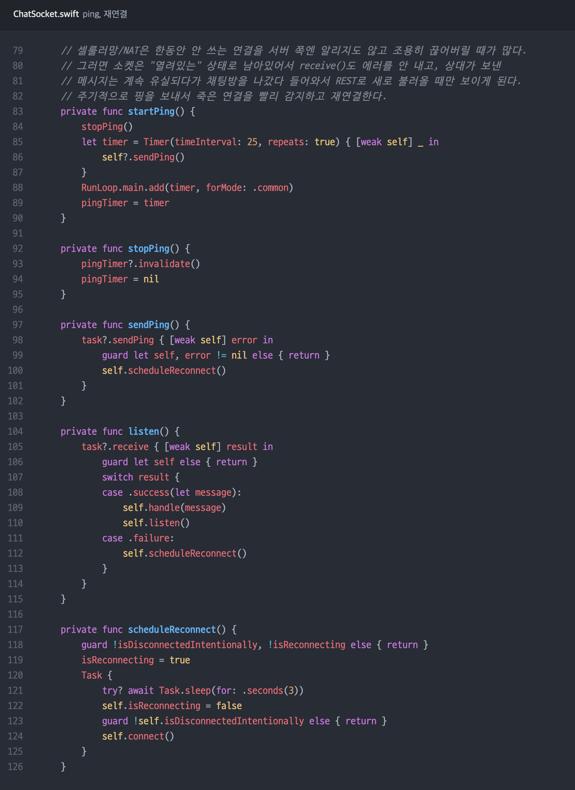
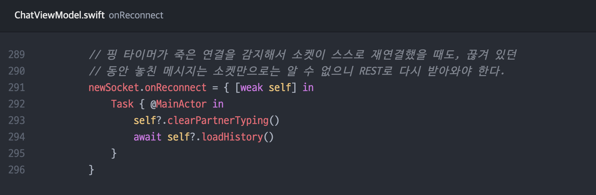
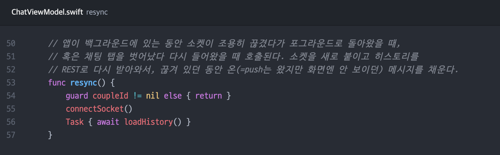
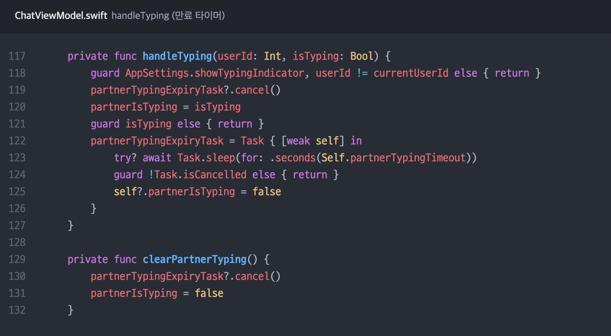
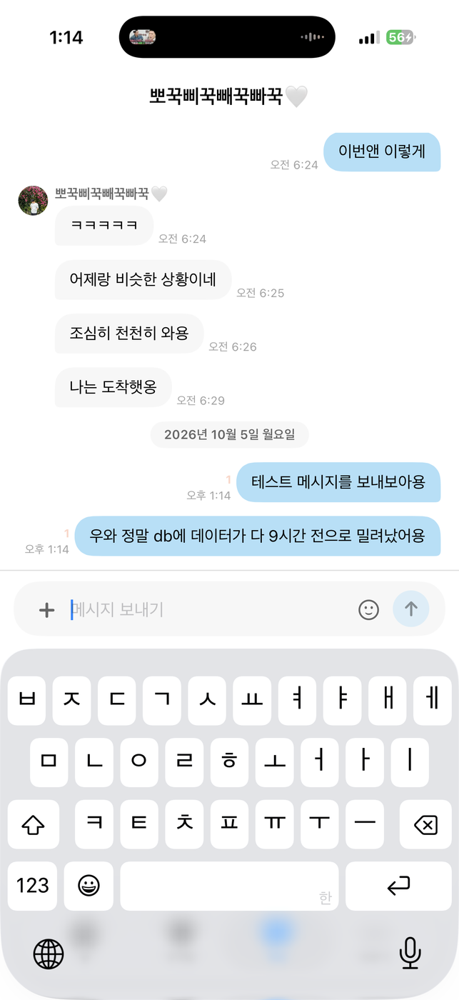
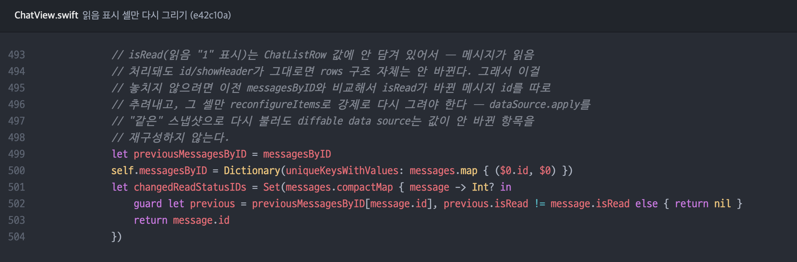
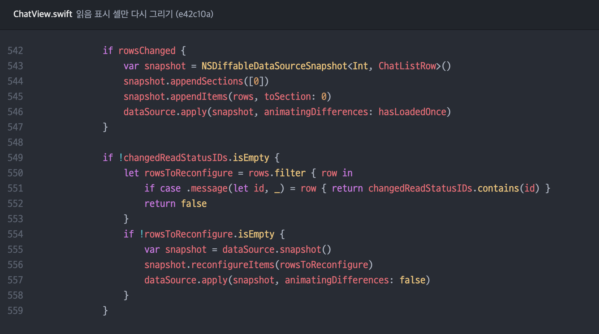

## 개요

- 우린 채팅을 쓰다 보면 이런 일이 있었다.
  - 상대가 보낸 메시지의 **푸시 알림은 왔는데**, 채팅 화면을 열어 보면 그 메시지가 없다.
  - 채팅방을 나갔다 들어오거나 앱을 껐다 켜야 보인다.
- 처음엔 서버가 메시지를 늦게 보내는 줄 알았다. 그런데 푸시는 제때 왔으니 서버는 정상이다.
- 문제는 **웹소켓이 끊긴 걸 앱이 모르고 있던 것**, 그리고 다시 붙어도 **끊긴 동안의 메시지를 채우지 않은 것**이었다.
- 고치다 보니 같은 뿌리의 문제가 둘 더 나왔다.
  - 상대가 입력을 멈췄는데 "입력 중(…)"이 계속 떠 있다.
  - 상대가 읽었는데 "1"이 안 사라진다.

## 구조

- 보내기는 REST, 받기는 웹소켓이다.
  - 앱은 커플 방(`/ws/chat?coupleId=N`)에 소켓을 붙여 두고 `MESSAGE`, `READ`, `TYPING` 이벤트를 받는다.
  - 푸시(FCM)는 소켓과 **별개의 경로**다. 그래서 소켓이 죽어 있어도 푸시는 온다.

## 0. 처음엔 재연결 자체가 없었다

- 채팅을 만든 다음 날(9/13) 먼저 부딪힌 건 **서버 쪽에서 끊기는** 경우였다.
  - 개발 중이라 서버가 devtools로 자동 재시작되거나, 당시 쓰던 ngrok 터널이 잠깐 끊기면 소켓이 죽었다.
  - 재연결 로직이 없어서, 앱을 **완전히 껐다 켜야** 실시간 수신이 돌아왔다.
  - 화면에 다시 들어와도 소용없었다. 같은 커플이면 `connect()`를 다시 부르지 않게 막아 뒀기 때문이다.
- 그래서 `receive()`가 실패하면 3초 뒤 소켓 스스로 다시 붙게 했다.
- 이건 서버가 연결을 **닫아 줄 때**만 동작한다. 아래 원인 1은 닫아 주지도 않고 사라지는 경우다.

## 원인 1. 끊겼는데 끊긴 줄 모른다

- 셀룰러망이나 공유기(NAT)는 한동안 아무것도 안 오가는 연결을 **양쪽에 알리지 않고** 정리해 버리는 경우가 많다.
  - 연결을 끊을 때 보내는 신호(FIN)가 없으니, 앱의 소켓은 여전히 "열림" 상태다.
  - `receive()`는 에러 없이 다음 메시지를 기다리기만 한다. 다음 메시지는 오지 않는다.
- 이른바 반쯤 열린(half-open) 연결이다. 무언가를 **보내 봐야** 끊긴 걸 알 수 있다.
- 그래서 25초마다 ping을 보낸다. 실패하면 3초 뒤에 다시 붙는다. (9/14)
  - 첫 재연결 로직을 넣은 지 하루 만이다. `receive()` 실패만 기다려서는 이 경우를 못 잡았다.

- ping 실패와 `receive()` 실패가 거의 동시에 나면 재연결이 두 번 걸린다. `isReconnecting` 플래그로 한 번만 예약되게 막았다.

## 원인 2. 다시 붙어도 놓친 메시지는 안 온다

- ping을 넣고 나서도 "나갔다 들어와야 보이는" 일이 남았다.
- 소켓은 **지금 이 순간** 일어나는 일만 전해 준다. 끊겨 있던 동안 서버가 뿌린 메시지는 다시 붙어도 돌아오지 않는다.
- 게다가 iOS는 앱이 백그라운드로 가면 소켓을 오래 살려 두지 않는다. 앱으로 돌아오는 순간이 가장 많이 놓치는 순간이다.
- 그래서 원칙을 하나 세웠다. **소켓은 "새 소식이 있다"를 빨리 알려주는 용도, 진짜 목록은 REST.**
  - 다시 붙을 때마다 REST로 최근 메시지를 다시 받아 채운다.
  - 다시 붙는 시점은 세 가지다.

- 최초 연결 때는 `onReconnect`를 부르지 않는다. 처음 화면을 열 때 이미 히스토리를 받아오니까 중복이다.
- REST로 받은 목록과 소켓으로 받은 메시지가 겹칠 수 있는데, 이건 [clientMessageId 글](/project/2026/11/23/Woorin-Chat-Idempotency/)에서 만든 짝짓기로 걸러진다.

## 원인 3. "끄기" 신호를 놓치면 영원히 켜져 있다

- "입력 중(…)"은 이렇게 동작했다.
  - 입력을 시작하면 `TYPING isTyping=true`, 3초간 입력이 없으면 `isTyping=false`를 보낸다.
  - 받는 쪽은 `false`가 올 때까지 …을 보여준다.
- 문제는 `false`가 **안 오는** 경우다.
  - 상대가 입력하다가 앱을 나가거나, 네트워크가 끊기거나, 내 소켓이 재연결하는 사이에 신호가 지나가면
  - …이 다음에 상대가 입력할 때까지 계속 떠 있다.
- 켜기/끄기 신호 쌍에 의존하는 대신, **유효기간이 있는 상태**로 바꿨다.

- 보내는 쪽은 계속 입력 중이면 **3초마다 "켜기"를 다시 보낸다.** 만료(6초)보다 짧아서 길게 써도 중간에 꺼지지 않는다.
- 그 밖에 바로 끄는 경우
  - 상대 메시지가 도착했을 때, 내 소켓이 재연결될 때 → 받는 쪽에서 끈다.
  - 채팅 화면을 벗어나거나 앱이 백그라운드로 갈 때 → 보내는 쪽이 소켓이 끊기기 전에 "끄기"를 보낸다.

## 원인 4. 이벤트는 왔는데 화면이 안 바뀐다

- 내가 보낸 메시지 옆의 "1"은 상대가 아직 안 읽었다는 표시다. 상대가 읽으면 `READ` 이벤트가 와서 사라져야 한다.
- 읽음 "1"이 안 사라지는 문제도 소켓을 의심했는데, 이번엔 소켓이 아니었다.
  - `READ` 이벤트는 잘 왔고, 메시지의 `isRead`도 `true`로 바뀌어 있었다.
- 원인은 직전에 넣은 **목록 최적화**였다.
  - 그 전날 밤(9/25 23:00~9/26 05:30) 채팅 화면의 **키보드 문제**와 씨름했다. 키보드를 열면 보던 메시지가 가려지거나 밀려나는 문제다.
  - 그 6시간 반 동안 커밋이 10개 넘게 쌓였다. 수정 → Revert → 재시도 → "마지막으로 확실히 동작하던 상태로 롤백" → 다시 시도.
  - 결국 05:30에 메시지 목록을 SwiftUI `ScrollView`에서 UIKit `UICollectionView`로 **통째로 바꿨다.** 스크롤 위치를 SwiftUI로는 정확히 잴 수 없었기 때문이다. (+337줄 / -135줄)
  - 이 전환에 같이 들어간 게 아래 최적화다. 읽음 "1" 회귀는 그로부터 **8시간 뒤**(13:22)에 고쳤다.
  - 채팅 목록은 diffable data source로 그린다. 스크롤 성능을 위해 "행 구성(rows)이 그대로면 apply를 건너뛰기"를 넣었다.
  - 그런데 행은 `(메시지 id, 헤더 표시 여부)`만 담고 있어서, **`isRead`만 바뀌면 rows는 그대로**다. 그래서 갱신 자체를 건너뛰었다.
  - 같은 스냅샷으로 apply를 다시 불러도 소용없다. diffable은 식별자가 같은 항목은 다시 그리지 않는다.
- 이전 상태와 비교해 `isRead`가 바뀐 메시지만 골라 `reconfigureItems`로 그 셀만 다시 그리게 했다.

## 반대 방향 버그: 안 봤는데 읽음 처리

- 읽음은 "안 사라지는" 문제 전에 "너무 빨리 생기는" 문제도 있었다. (9/13)
- 탭 화면(`TabView`)은 채팅 탭을 안 보고 있어도 채팅 화면과 소켓을 살려 둔다.
  - 그런데 메시지가 소켓으로 도착하기만 하면 무조건 읽음 처리를 보내고 있었다. 홈 탭에 있어도 상대 화면에선 "1"이 바로 사라졌다.
- 앱이 포그라운드이고 채팅 탭이 실제로 보일 때만 읽음 처리하도록 `isViewingChat`으로 구분했다.
  - 위 `resync()`도 이 값으로 "다시 나타났을 때"를 판단한다.

## 커밋으로 본 흐름

| 날짜 | 어디 | 커밋 |
|---|---|---|
| 9/13 03:44 | iOS | 소켓 끊기면 3초 뒤 자동 재연결 |
| 9/13 18:11 | iOS | 다른 탭에 있을 때 잘못 읽음 처리되던 버그 수정 (`isViewingChat`) |
| 9/14 21:26 | iOS | 25초 ping으로 조용히 끊긴 연결 감지 |
| 9/17 23:24 | iOS | 포그라운드 복귀/탭 재진입/재연결 때 REST로 재동기화 |
| 9/19 23:39 | 서버+iOS | 입력 중(TYPING) 이벤트 중계, 입력 중 표시 |
| 9/26 05:30 | iOS | 키보드 문제 끝에 메시지 목록을 `UICollectionView`로 전환 |
| 9/26 13:22 | iOS | 읽음 "1" 안 사라지던 회귀 수정 (`reconfigureItems`) |
| 10/1 02:20 | iOS | 입력 중 표시에 6초 만료, 3초마다 재전송 |
| 10/1 02:38 | iOS | 입력 중 표시가 뜨면 맨 아래로 스크롤 |
| 10/12 23:31 | Android | 채팅 화면/실시간 통신 포팅 |
| 10/18 22:10 | 서버 | 우린로그 올림/삭제도 커플 웹소켓으로 알림 |

- 채팅 소켓은 이제 채팅 전용이 아니다. 10/18부터 우린로그 이벤트도 같은 커플 채널로 받는다. **"커플 둘만의 실시간 채널"** 이 된 셈이다.

## 정리

- 모바일에서 소켓은 **조용히 끊긴다.** 끊긴 걸 알려면 보내 봐야 한다. (ping)
- 소켓은 놓친 걸 다시 주지 않는다. 다시 붙을 때마다 **REST로 다시 맞춘다.** 소켓은 빠른 알림, 진실은 REST.
- 켜기/끄기 쌍으로 된 상태는 끄기를 놓치면 영원히 남는다. **유효기간을 두고 주기적으로 갱신**하면 신호를 놓쳐도 스스로 회복한다.
- "실시간이 안 된다"의 원인이 항상 실시간 쪽에 있는 건 아니다. 읽음 표시는 화면 갱신 최적화가 원인이었다.

## Reference

<https://developer.apple.com/documentation/foundation/urlsessionwebsockettask>

<https://datatracker.ietf.org/doc/html/rfc6455#section-5.5.2>

<https://developer.apple.com/documentation/uikit/nsdiffabledatasourcesnapshot/reconfigureitems(_:)>
