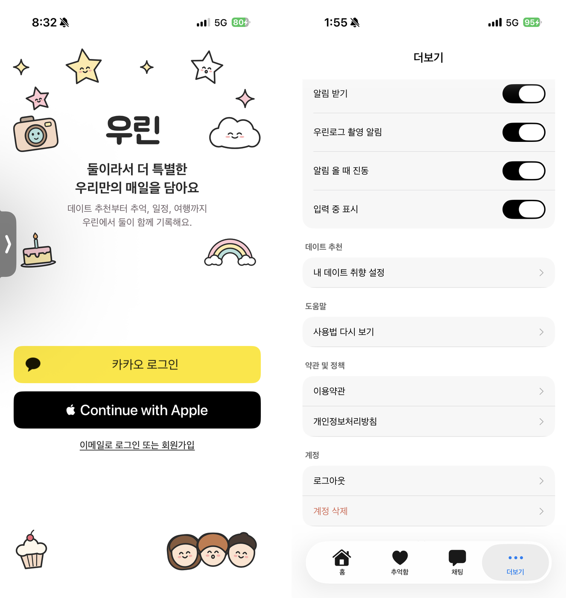
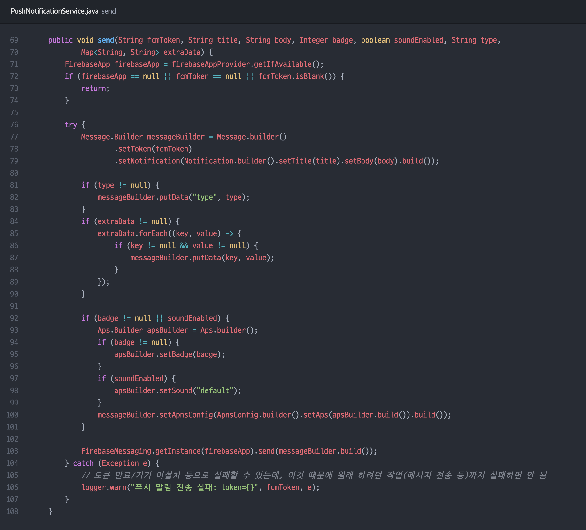
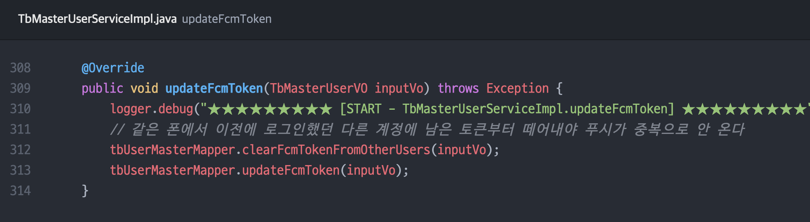
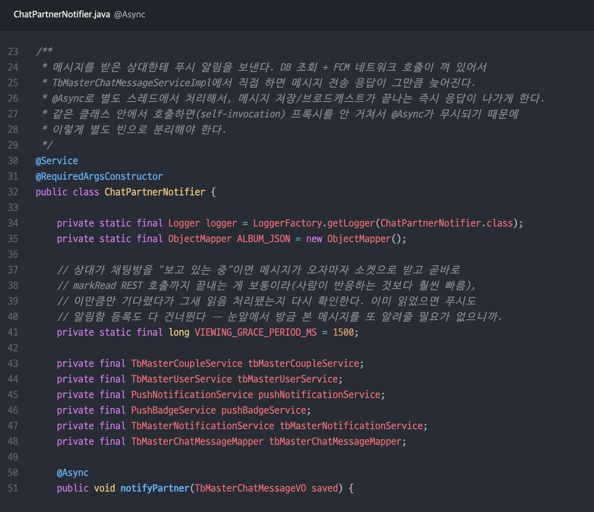
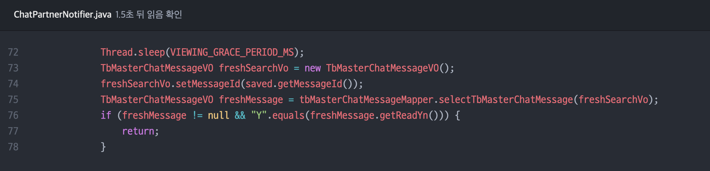
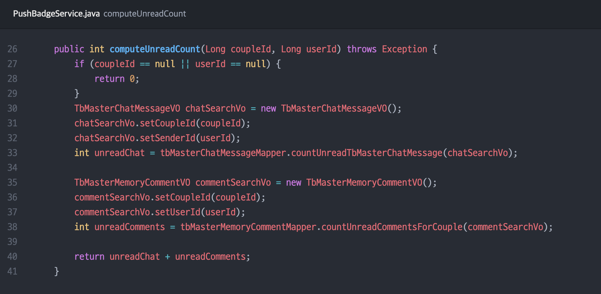
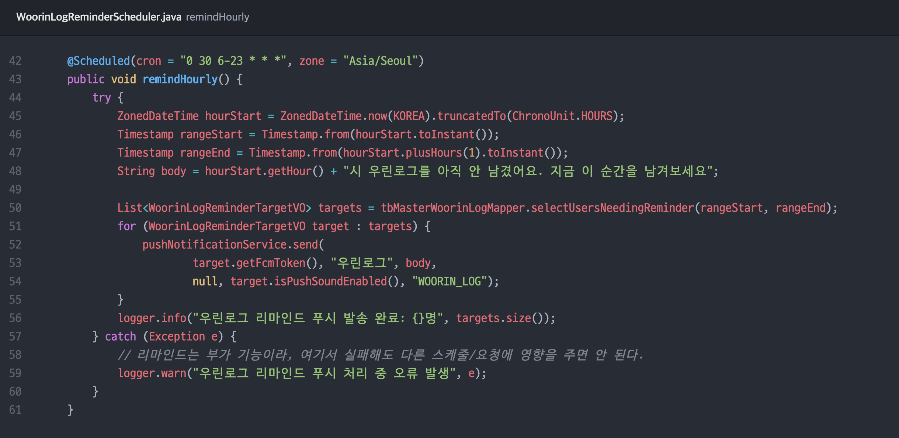

## 개요



- 왼쪽은 로그인 화면, 오른쪽은 더보기의 알림 설정이다. 알림 받기, 우린로그 촬영 알림, 진동을 따로 켜고 끌 수 있다.
- 우린은 채팅, 추억, 일정, 우린로그 리마인드를 FCM(Firebase Cloud Messaging)으로 보낸다.
- 보내는 것 자체는 Firebase Admin SDK 몇 줄이면 된다. 서버에서 오래 걸린 건 그 주변이었다.
  - 같은 알림이 **두 번씩** 왔다.
  - 푸시 때문에 **메시지 전송 응답이 느려졌다.**
  - 채팅방을 **보고 있는데도** 알림이 왔다.
  - 앱 아이콘의 **안 읽은 개수**를 서버가 계산해서 실어 보내야 했다.

## 구조

- 앱은 실행할 때 Firebase에서 받은 FCM 토큰을 서버에 올린다. (`PUT /api/users/{userId}/fcm-token`)
- 서버는 회원 테이블의 `FCM_TOKEN` 컬럼에 저장하고, 푸시를 보낼 때 받는 사람의 토큰으로 보낸다.
- 보내는 곳은 `PushNotificationService` 한 곳이다.



- **`notification`**(제목, 본문)은 기기가 알림 배너로 보여준다.
- **`data`**에는 알림 종류(`type`: `CHAT`, `MEMORY`, `CALENDAR` …)와 글 번호 같은 값을 싣는다.
  - 배너에는 안 보이는 값이라, 앱이 "알림을 누르면 어느 화면으로 갈지", "채팅을 읽으면 어떤 알림을 지울지" 판단하는 데 쓴다.
  - 알림함 테이블(`TB_MASTER_NOTIFICATION`)에 쓰는 종류 값과 같은 문자열을 쓴다. 서버 안에서 알림 종류가 한 가지 이름으로 통한다.
- **`aps`**(iOS 전용)에는 아이콘 배지 숫자와 소리를 싣는다.
  - iOS는 `aps.sound`가 있어야 잠금화면에서 소리·진동을 울린다. 그래서 회원별 "알림 올 때 진동" 설정이 꺼져 있으면 `aps.sound`를 **아예 빼는** 게 그 설정의 실제 동작이다.
- 전송이 실패해도(토큰 만료, 앱 삭제 등) 예외를 밖으로 던지지 않는다. 푸시는 부가 기능이라, 푸시 실패 때문에 메시지 저장 같은 핵심 기능이 실패하면 안 된다.

## 1. 같은 알림이 두 번씩 왔다

- 우린로그 리마인드 같은 푸시가 **두 번씩** 울렸다.
  - 리마인드는 매시 30분(06~23시)에, 그 시간에 아직 우린로그를 안 올린 사람에게 보낸다. 하루에도 여러 번 오는 알림이라 두 번씩 오면 바로 티가 났다.
- 원인은 **같은 폰에서 계정을 바꿔 로그인**한 것이었다.

```
폰 A에서 계정 1로 로그인  → USER 1 의 FCM_TOKEN = tokenA
로그아웃 (서버는 그대로)
폰 A에서 계정 2로 로그인  → USER 2 의 FCM_TOKEN = tokenA

리마인드 발송: USER 1 → tokenA, USER 2 → tokenA   →  폰 A에 두 번
```

- FCM 토큰은 **앱 설치(기기)마다** 발급된다. 계정을 바꿔도 같은 폰이면 같은 토큰이다.
- 서버는 토큰을 "회원의 속성"으로 다루고 있어서, 한 토큰이 여러 회원에게 붙는 걸 막지 않았다.
  - 로그아웃한 계정 앞으로 온 알림이 계속 그 폰으로 오는 문제도 같은 원인이다.

### 한 기기 = 한 계정

- 토큰을 등록할 때, **같은 토큰을 가진 다른 계정에서 먼저 떼어낸다.**




- 로그아웃 API(`DELETE /api/users/{userId}/fcm-token`)도 만들었다. 앱은 로그아웃하기 직전, 인증 토큰이 아직 살아 있을 때 이걸 부른다.
  - 오프라인이라 이 호출이 실패해도 괜찮다. 다음에 누가 그 폰으로 로그인하면 위의 등록 로직이 다른 계정의 토큰을 정리해 준다.
- 토큰을 별도 테이블(기기 테이블)로 빼는 방법도 있다. 한 계정이 여러 기기를 쓰려면 그게 맞다. 우린은 "한 사람 = 폰 하나"라서 컬럼 하나에 "한 토큰은 한 계정에만"이라는 규칙을 더하는 쪽으로 충분했다.

## 2. 푸시 때문에 메시지 전송이 느려졌다

- 채팅을 보내면 서버는 메시지를 저장하고, 상대에게 푸시를 보낸다.
- 처음엔 이걸 **요청 스레드에서 차례로** 했다.
  - 상대 정보 조회, 보낸 사람 닉네임 조회, 안 읽은 개수 계산(배지), FCM 전송(외부 네트워크 호출), 알림함 저장
  - 이게 다 끝나야 응답이 나가서, 보내는 사람의 "전송 완료"가 그만큼 늦게 떴다.
- 푸시를 `@Async`로 별도 스레드에서 보내도록 바꿨다.



- 여기서 주의할 점이 있다. 메시지 서비스 안에 `@Async` 메서드를 만들어 같은 클래스에서 부르면 **비동기로 돌지 않는다.**
  - 스프링은 프록시로 `@Async`를 건다. 프록시를 거쳐서 들어온 호출만 비동기가 된다.
  - 같은 클래스 안에서 자기 메서드를 부르면(`this.notifyPartner()`) 프록시를 거치지 않아서, 어노테이션이 있어도 그냥 동기로 실행된다.
- 그래서 푸시 보내는 쪽을 **별도 빈**(`ChatPartnerNotifier`)으로 분리했다. 메시지 서비스는 이 빈을 주입받아 부른다.
- [부하 테스트 글](/project/2026/11/23/Woorin-Chat-Load-Test/)에서 "응답 시간에는 안 보여도 DB는 같이 쓴다"고 한 게 이 `@Async`다. 스레드는 나눴지만 DB 커넥션 풀은 같이 쓴다.

## 3. 채팅방을 보고 있는데 알림이 왔다

- 상대가 지금 채팅방을 보고 있으면, 메시지는 웹소켓으로 바로 도착하고 곧바로 읽음 처리된다.
- 그런데도 푸시와 알림함 알림이 매번 같이 나갔다. 눈앞에서 방금 본 메시지를 또 알려주는 셈이다.
- 서버는 상대가 "지금 보고 있는지"를 직접 알 수 없다. 대신 **"곧 읽음 처리되는지"는 알 수 있다.**
  - 보고 있는 앱은 메시지를 받자마자 읽음 처리 API를 부른다. 사람이 반응하는 것보다 훨씬 빠르다.
  - 그래서 푸시를 보내기 전에 **1.5초** 기다렸다가, 그 메시지가 그새 읽음 처리됐는지 다시 확인한다.



- 이미 읽었으면 푸시도, 알림함 등록도 건너뛴다.
- 이 기다림은 2번에서 분리한 **비동기 스레드**에서 한다. 메시지 전송 응답에는 영향이 없다.
- 읽음 처리 자체는 [읽음 처리 글](/project/2026/11/24/Woorin-Chat-Read-Receipt/)에 따로 정리했다.

## 4. 아이콘 배지 숫자는 서버가 계산한다

- iOS 앱 아이콘의 빨간 숫자는 푸시에 실린 `aps.badge` 값으로 바뀐다. 앱이 꺼져 있어도 바뀌어야 하니, **서버가 계산해서 실어 보내야** 한다.



- 숫자는 "안 읽은 채팅 + 안 읽은 추억 댓글"이다.
- 푸시를 보낼 때마다 이 계산이 돈다. 안 읽은 채팅 수를 세는 쿼리가 대화가 쌓이면 느려졌던 이야기, 그리고 인덱스로 고친 이야기는 [부하 테스트 글](/project/2026/11/23/Woorin-Chat-Load-Test/)에 있다.
- 앱이 스스로 배지를 동기화할 수 있게, 같은 계산을 돌려주는 API(`GET /api/users/{id}/badge-count`)도 뒀다.

## 5. 리마인드는 스케줄러로



- 매시 30분, 06~23시에 돈다. 자정부터 새벽 6시까지는 보내지 않는다.
- cron에 `zone = "Asia/Seoul"`을 **명시**했다.
  - 운영 서버의 OS 시간대가 무엇이든 "한국 시각 6시~23시"가 유지되게 하려는 것이다. 서버 시간대 설정이 어긋나면 시각이 통째로 밀린다. ([에러 없이 실패하는 서버 버그들](/project/2026/11/23/Woorin-Silent-Failures/))
- 리마인드도 부가 기능이라, 실패해도 예외를 밖으로 던지지 않고 로그만 남긴다. 발송 인원은 운영 로그(INFO)에 남겨서 돌았는지 확인할 수 있게 했다.

## 정리

- **FCM 토큰은 사용자가 아니라 기기(앱 설치)의 것이다.** 한 토큰은 한 계정에만 붙어 있어야 하고, 로그아웃하면 떼어내야 한다.
- 외부 네트워크 호출이 낀 부가 작업은 요청 스레드에서 빼낸다. `@Async`는 **다른 빈에서 불러야** 동작한다.
- 서버가 "보고 있는지"를 모를 때는, 그 결과("곧 읽음 처리되는지")를 보고 판단할 수 있다.
- 푸시에는 보여줄 내용(`notification`)과 앱이 판단할 값(`data`)을 나눠 싣는다. 종류를 실어 두면 화면 이동, 알림 정리 등 쓸 데가 계속 생긴다.

## Reference

<https://firebase.google.com/docs/cloud-messaging/manage-tokens>

<https://firebase.google.com/docs/cloud-messaging/concept-options#notifications_and_data_messages>

<https://docs.spring.io/spring-framework/reference/integration/scheduling.html#scheduling-annotation-support-async>
