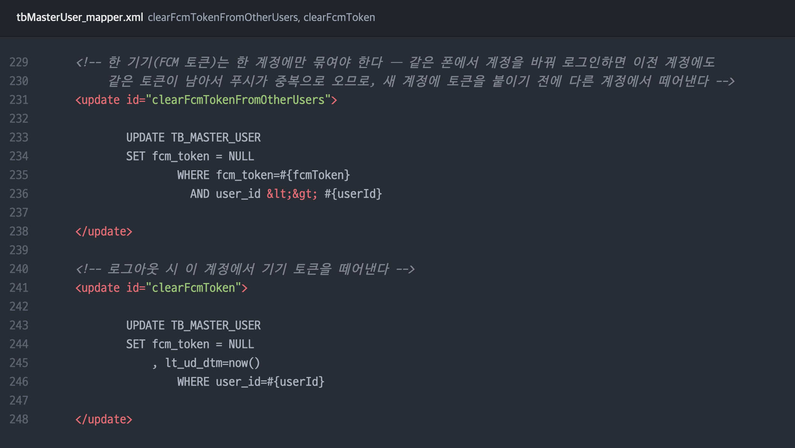

## 개요


- 왼쪽은 로그인 화면, 오른쪽은 더보기의 알림 설정이다. 알림 받기, 우린로그 촬영 알림, 진동을 따로 켜고 끌 수 있다.
- 우린은 채팅, 추억, 일정, 우린로그 리마인드(매시 30분 촬영 알림)를 푸시로 보낸다.
- 푸시는 기능을 만드는 것보다 **"잘 오게" 만드는 게** 더 오래 걸렸다.
  - 같은 알림이 **두 번씩** 왔다.
  - 아이폰에서 FCM 토큰 등록이 **조용히 실패**하고 있었다.
  - 채팅을 읽어도 잠금화면의 채팅 알림이 **안 사라졌다.**
  - 안드로이드는 무음 모드에서 알림이 **조용히 쌓이기만** 했다.
- 가장 오래 헤맨 건 첫 번째였다. 원인은 **"토큰은 사용자가 아니라 기기의 것"** 이라는 걸 놓친 데 있었다.

## 구조

- 앱은 실행 때 Firebase에서 받은 FCM 토큰을 서버에 올린다. (`PUT /api/users/{userId}/fcm-token`)
- 서버는 회원 테이블의 `FCM_TOKEN` 컬럼에 저장하고, 푸시를 보낼 때 받는 사람의 토큰으로 보낸다.
- 회원 한 명에 토큰 하나. 단순하다.

## 1. 알림이 두 번씩 온다

- 우린로그 리마인드 같은 푸시가 **두 번씩** 울렸다.
  - 리마인드는 10/5에 넣은 기능이다. 오늘 아직 우린로그를 안 올린 커플에게 **06~23시 매시간** 보낸다. 하루 최대 18번이라, 두 번씩 오면 바로 티가 났다.
- 원인은 **같은 폰에서 계정을 바꿔 로그인**한 것이었다.

```
폰 A에서 계정 1로 로그인  → USER 1 의 FCM_TOKEN = tokenA
로그아웃 (서버는 그대로)
폰 A에서 계정 2로 로그인  → USER 2 의 FCM_TOKEN = tokenA

리마인드 발송: USER 1 → tokenA, USER 2 → tokenA   →  폰 A에 두 번
```

- FCM 토큰은 **앱 설치(기기)마다** 발급된다. 계정을 바꿔도 같은 폰이면 같은 토큰이다.
- 서버는 토큰을 "회원의 속성"으로 다루고 있어서, 한 토큰이 여러 회원에게 붙는 걸 막지 않았다.
  - 로그아웃한 계정 앞으로 온 알림이 계속 이 폰으로 오는 문제도 같은 원인이다.

### 한 기기 = 한 계정

- 토큰을 등록할 때, **같은 토큰을 가진 다른 계정에서 먼저 떼어낸다.**




- 로그아웃할 때도 지운다. (`DELETE /api/users/{userId}/fcm-token`)
  - 순서가 중요하다. 이 API도 인증이 필요하니, **인증 토큰이 살아 있을 때** 먼저 지우고 나서 로그아웃 상태로 바꾼다.
  - 오프라인이라 실패해도 로그아웃은 막지 않는다. 다음에 누가 그 폰으로 로그인하면 위의 등록 로직이 정리해 준다.


## 2. 토큰 등록이 401을 받고 있었다

- API에 인증 토큰을 도입한 직후 생긴 문제다.
- 다른 API는 다 되는데, FCM 토큰 등록만 **`URLSession`으로 직접** 짜여 있었다.
  - 공통 클라이언트(`APIClient`)를 거치지 않으니 `Authorization` 헤더가 안 실렸고, 서버는 401을 돌려줬다.
  - 실패는 `print`로만 찍혀서 화면에는 아무 표시가 없었다.
- 인증 커밋(9/14 00:19)과 이 수정(00:24)이 **5분** 차이다.
- 그런데 같은 날 01:16에 **사진 업로드도 같은 이유로 401**이 났다. 커밋 메시지에 "FCM 토큰 업로드 때와 같은 패턴의 버그"라고 적었다. 한 번 고치고도 같은 패턴을 다른 곳에서 또 만났다.
- `APIClient.send`를 쓰도록 바꿨다. 이런 "한 곳만 다르게 짠 요청"은 공통 규칙이 바뀔 때 꼭 빠진다.

## 3. 읽었는데 알림이 안 사라진다

- 채팅 푸시를 보고 앱을 열어 대화를 다 읽어도, 알림센터와 잠금화면에 채팅 알림이 그대로 남았다.
- iOS는 앱 안에서 읽었다고 **이미 도착한 알림을 알아서 치워주지 않는다.**
  - 배지 숫자를 0으로 바꿔도 알림 자체는 남는다.
- 앱이 직접 지워야 한다. 그런데 어떤 알림이 채팅 알림인지 알아야 한다.
  - 서버가 푸시를 보낼 때 data payload에 `type`(`CHAT`, `MEMORY`, …)을 실어 보내도록 하고,
  - 앱은 채팅을 읽음 처리한 직후 `type == "CHAT"`인 알림만 골라 지운다.


- 이 `type`은 알림을 눌렀을 때 해당 화면으로 보내는 데에도 같이 쓴다.

## 4. 안드로이드는 조용히 쌓이기만 했다

- iOS 앱을 안드로이드로 옮긴 뒤, 무음(진동) 모드인 폰에서 알림이 **소리도 진동도 없이** 조용히 쌓였다.
- 안드로이드 8부터 알림은 **채널** 단위로 소리, 진동, 중요도를 정한다.
  - 처음 만든 채널(`woorin_default`)은 진동이 꺼진 상태였다.
- 그런데 채널 설정을 고쳐도 **반영이 안 됐다.**
  - 채널은 한 번 만들어지면 그 뒤로는 **사용자만** 설정을 바꿀 수 있다. 앱이 같은 id로 다시 만들어도 무시된다.
- 그래서 **새 id로 채널을 만들고**, 예전 채널은 지웠다.


- 처음엔 `lockscreenVisibility = VISIBILITY_PUBLIC`도 같이 넣었다. 잠금화면에 내용까지 보이게 하려고.
  - 그런데 채널의 잠금화면 표시는 **시스템만 바꿀 수 있는 값**이라, 앱이 넣어도 무시된다. 효과 없는 줄이라 나중에 지웠다.
  - 잠금화면에 내용을 보일지는 사용자의 기기 설정이 정한다. 앱이 할 수 있는 건 중요도(`IMPORTANCE_HIGH`)와 진동까지다.
- 서버 푸시에는 안드로이드 채널 지정이 없어서, 매니페스트의 기본 채널 id(`default_notification_channel_id`)도 같이 바꿔야 했다.

## 5. 푸시가 메시지 전송을 늦췄다

- 채팅을 보내면 서버는 메시지를 저장하고, 상대에게 푸시를 보낸다.
- 처음엔 이걸 **요청 스레드에서 차례로** 했다. FCM 전송과 안 읽은 수 조회가 끝나야 응답이 나가서, 보내기가 그만큼 느렸다.
- 푸시를 `@Async`로 별도 스레드에서 보내도록 바꿨다. (9/17)
  - 그런데 같은 클래스 안에서 `@Async` 메서드를 부르면 **적용이 안 된다.** 스프링은 프록시로 비동기를 거는데, 클래스 안에서 자기 메서드를 부르면 프록시를 거치지 않는다.
  - 그래서 푸시 보내는 쪽을 별도 빈(`ChatPartnerNotifier`)으로 분리했다.
- [부하 테스트 글](/project/2026/11/23/Woorin-Chat-Load-Test/)에서 "응답 시간에는 안 보여도 DB는 같이 쓴다"고 한 그 `@Async`가 이것이다.

## 6. 보고 있는 채팅에도 알림이 왔다

- 상대가 지금 채팅방을 보고 있으면 메시지는 곧바로 읽음 처리된다. 그런데도 푸시와 알림함 알림이 매번 같이 나갔다.
- 저장 직후 바로 알림을 보내지 않고 **1.5초 기다린 뒤**, 그 메시지가 그새 읽음 처리됐는지 다시 확인한다. 읽었으면 푸시와 알림함 등록을 둘 다 건너뛴다. (9/19)
- 앱 쪽도 맞췄다. 앱이 켜져 있을 때 온 채팅 푸시는 배너와 소리 대신 배지만 갱신한다. (9/13)

## 정리

- **FCM 토큰은 사용자가 아니라 기기(앱 설치)의 것이다.** 한 토큰은 한 계정에만 붙어 있어야 하고, 로그아웃하면 떼어내야 한다.
- 푸시 실패는 앱 화면에 아무것도 안 남는다. 등록 실패를 `print`로만 남기면 아무도 모른다.
- 알림은 "보내기"만이 아니라 **"치우기"까지** 앱이 챙겨야 한다. 그러려면 알림에 종류(type)를 실어 보내야 한다.
- 안드로이드 알림 채널은 **처음 만들 때 제대로** 만들어야 한다. 바꾸려면 새 채널을 만드는 수밖에 없다.

## Reference

<https://firebase.google.com/docs/cloud-messaging/manage-tokens>

<https://developer.apple.com/documentation/usernotifications/unusernotificationcenter/removedeliverednotifications(withidentifiers:)>

<https://developer.android.com/develop/ui/views/notifications/channels>
