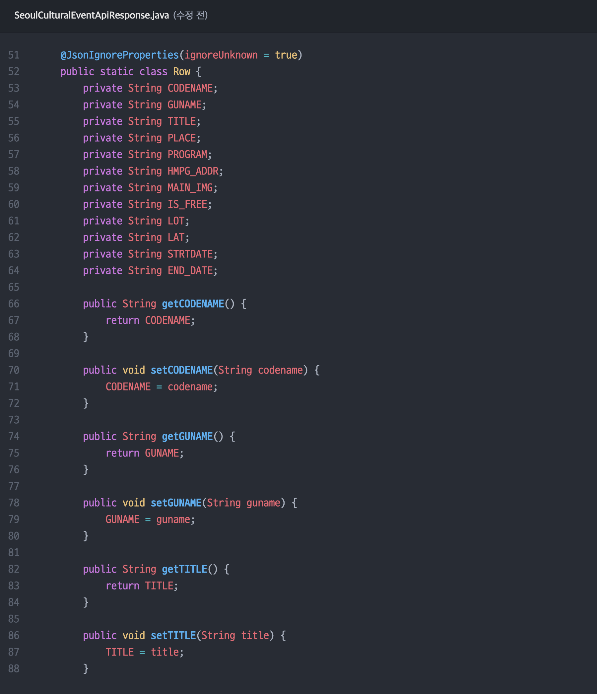
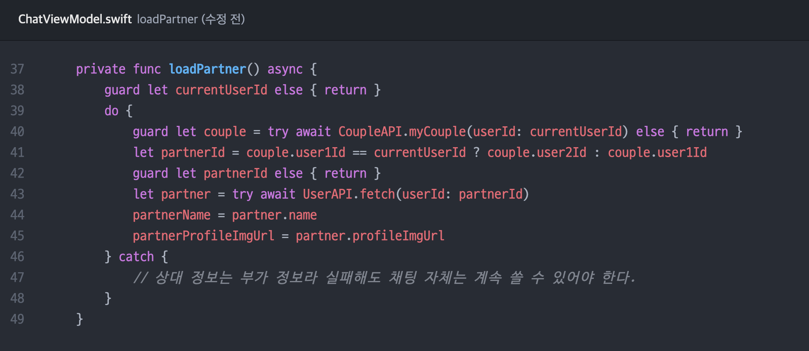
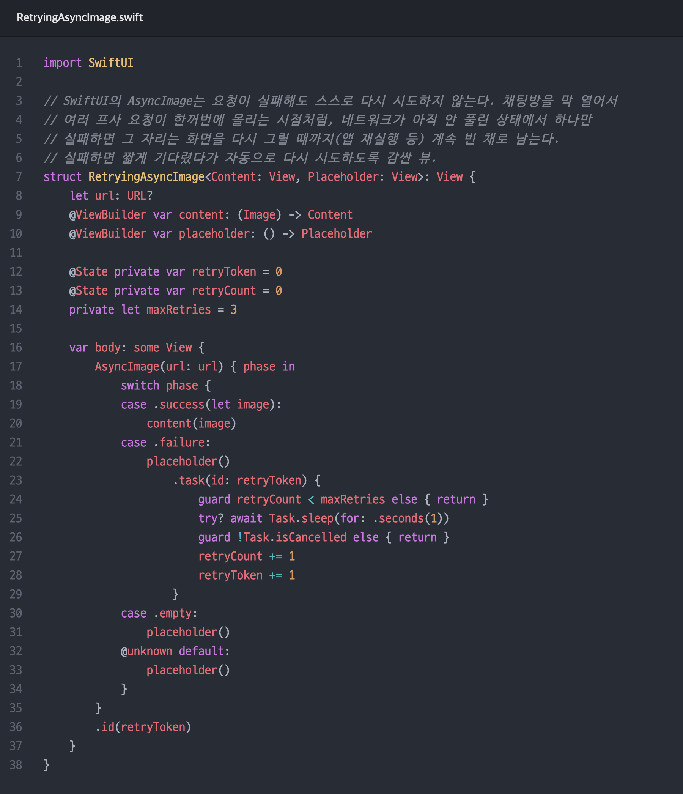
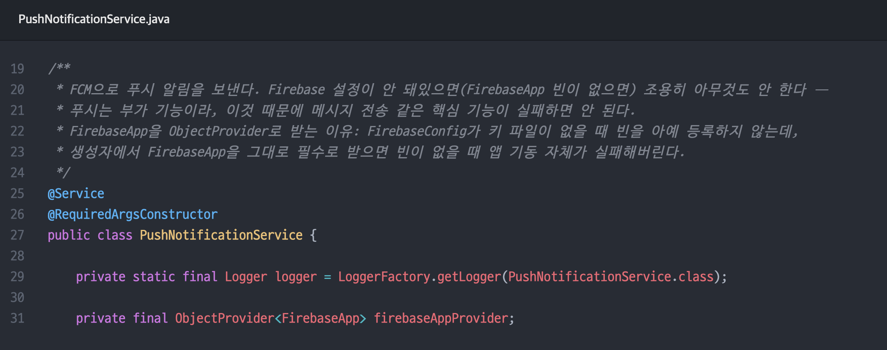
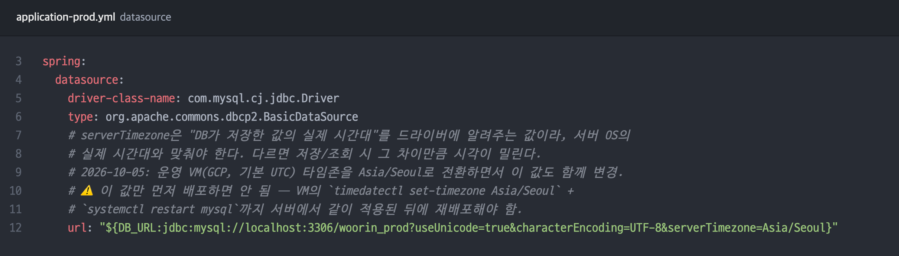
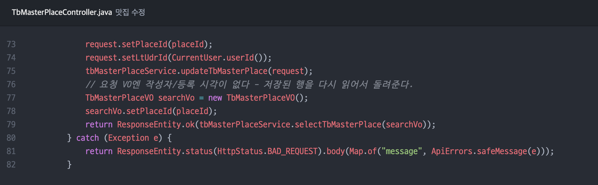
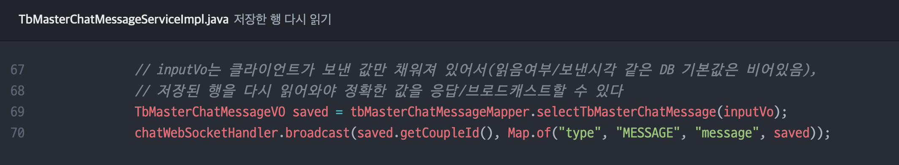

## 개요

- 우린 서버를 운영하면서 가장 오래 헤맨 버그들은 공통점이 있었다. **에러가 안 났다.**
  - 예외도, 빨간 로그도, 서버 다운도 없이 "그냥 안 되는" 상태였다.
- 이번 글은 그런 버그 다섯 가지를 어떻게 찾았는지 정리한다.
  1. 외부 API 응답은 잘 오는데 저장이 **0건**
  2. 배포할 때마다 **푸시가 조용히 꺼졌다**
  3. 모든 시각이 **9시간씩 밀렸다**
  4. 저장은 됐는데 앱에는 **"실패"**로 떴다
  5. 상대 프로필이 **안 바뀐다** → 사실은 403

## 1. API는 응답이 잘 오는데 저장은 0건

### 증상

- 우린에는 서울시 문화행사를 데이트 후보로 보여주는 기능이 있다.
  - 서울 열린데이터광장 API에서 행사를 받아와 DB에 저장한다. (서버 첫 기동 때 한 번, 이후 매일 새벽 3시)
- 동기화를 돌려 보니, 에러 로그도 없이 끝나는데 **저장은 늘 0건**이었다.

### 찾기

- 일단 API 응답부터 의심했다. 키가 틀렸거나, 응답이 비었거나.
- 로그를 하나 넣었다. 응답의 전체 건수와 받은 행 수를 찍는다.

```java
logger.info("문화행사 API 응답: total={}, rowCount={}", total, rows == null ? "null" : rows.size());
```

- 결과는 **total도 rowCount도 정상**이었다. 행은 잘 왔다.
- 그러면 행 안의 값이 문제다. 확인해 보니 **필드가 전부 null**로 채워져 있었다.

### 원인: Jackson이 `TITLE`을 `title`로 읽는다

- API 응답은 필드 이름이 전부 대문자다.

```json
{ "TITLE": "...", "CODENAME": "...", "GUNAME": "...", "STRTDATE": "..." }
```

- 받는 클래스도 원본 이름 그대로 만들었다.



- Jackson은 필드가 private이면 **getter/setter 이름에서** 프로퍼티 이름을 만든다.
  - `setTITLE` → 앞의 `set`을 떼고 → `TITLE` → 기본 규칙은 **앞쪽 대문자들을 소문자로** 바꾼다 → `title`
  - 그래서 Jackson이 기다리는 키는 `title`이고, JSON의 `TITLE`은 "모르는 필드"가 된다.
- 여기에 `@JsonIgnoreProperties(ignoreUnknown = true)`가 붙어 있었다.
  - 모르는 필드는 **조용히 버린다.** 예외가 없으니 모든 필드가 null인 객체가 정상적으로 만들어졌다.
- 외부 API 응답에 필드가 추가돼도 안 깨지게 하려고 넣은 설정이, 이번엔 매핑 실패를 숨겼다.

### 해결


- 필드마다 JSON 이름을 `@JsonProperty`로 명시했다.
- 로그 한 줄로 "응답은 왔다 / 값이 비었다"를 나누고 나서야 원인이 바로 보였다. 그 전까지는 "API 키가 틀렸나"만 의심했다.

## 2. 배포할 때마다 푸시가 조용히 꺼졌다

### 증상

- 어느 순간부터 푸시가 하나도 안 왔다. 채팅, 추억, 일정 전부.
- 서버 로그에는 푸시 관련 에러가 **한 줄도** 없었다.

### 원인: 배포가 Firebase 키를 지웠다

- 배포는 GitLab CI가 소스를 `rsync`로 서버에 올리고, 서버에서 빌드해서 재시작한다.



- `rsync --delete`는 "소스에 없는 파일은 서버에서도 지운다"는 옵션이다.
- Firebase 서비스 계정 키(`secrets/firebase-service-account.json`)는 git에 올리면 안 되는 파일이라 `.gitignore`에 있고, 서버에만 직접 넣어 뒀다.
  - CI가 올리는 소스(git 저장소)에는 이 파일이 없다.
  - 그래서 `rsync --delete`는 배포할 때마다 이 파일을 "있으면 안 되는 파일"로 보고 **지웠다.**
- 지금 설정에는 `--exclude='secrets'`가 들어가 있다. 업로드 파일(`uploads`)처럼 서버에만 있는 폴더는 전부 제외 목록에 넣어야 한다.

### 왜 에러가 안 났나

- 키가 없을 때 서버가 **죽지 않도록** 일부러 만들어 둔 구조 때문이다.



- 키 파일을 못 읽으면 `FirebaseApp` 빈을 만들지 않고(null) 서버는 정상 기동한다. 키가 없어도 서버가 뜨도록 일부러 이렇게 했다.



- 보내는 쪽은 `FirebaseApp`을 `ObjectProvider`로 받아서, 없으면 **아무것도 안 하고 돌아간다.**
- "푸시는 부가 기능이니, 없어도 핵심 기능은 돌아가야 한다"는 의도대로 동작한 것이다. 문제는 그 상태가 **운영에서도 조용했다**는 것이다.
  - 개발 환경에서 "키가 없으니 푸시는 끈다"는 정상이지만, 운영에서 "키가 없다"는 사고다. 같은 코드 경로가 두 상황을 구분하지 않았다.

## 3. 모든 시각이 9시간씩 밀렸다

### 증상

- 운영 서버에 배포했더니 화면에 보이는 시각이 **전부 9시간씩** 어긋나 있었다.
- 로컬에서는 멀쩡했다.

### 원인: `serverTimezone`



- MySQL JDBC URL의 `serverTimezone`은 "**DB에 저장된 값이 어느 시간대 기준인지**"를 드라이버에 알려주는 값이다.
  - 화면에 보여줄 시간대(한국)가 아니라, **DB 서버가 실제로 쓰는 시간대**와 맞춰야 한다.
  - 둘이 다르면 드라이버가 저장할 때와 읽을 때 그 차이만큼 시각을 옮겨서, 정확히 9시간이 밀린다.
- 처음엔 `serverTimezone=Asia/Seoul`이었다.
  - 로컬 개발 환경(맥)은 시간대가 한국이라, MySQL도 한국 시간으로 돌았다. 설정과 실제가 **우연히** 맞았다.
  - 운영 서버(GCP VM)는 기본 시간대가 **UTC**였다. 설정은 한국인데 DB는 UTC라 9시간이 밀렸다.
- 설정을 `serverTimezone=UTC`로 바꿔 맞췄다.

### 한 번 더: 서버 시간대를 한국으로 옮길 때

- 나중에 운영 VM의 시간대를 아예 한국 시간으로 옮겼다.
- 이때는 세 가지를 **같이** 바꿔야 한다.
  - VM 시간대 (`timedatectl set-timezone Asia/Seoul`)
  - MySQL 재시작 (MySQL은 기동할 때 OS 시간대를 읽는다)
  - `serverTimezone=Asia/Seoul`로 바꾼 서버 배포
- 하나라도 순서가 어긋나면 그 사이에는 또 9시간이 밀린다. 위 채팅은 전환하던 날 테스트 메시지를 보내 보며 주고받은 것이다.
- `DATETIME` 컬럼에는 시간대 정보가 없다. 저장된 건 "2026-10-05 13:14:00" 같은 **벽시계 값**뿐이고, 그게 어느 시간대 기준인지는 이 설정이 정한다. 그래서 설정만 바뀌어도 이미 저장된 값의 의미가 바뀐다.
- 시각이 의미 있는 코드에는 시간대를 코드에 직접 적어 둔다. 예를 들어 리마인드 스케줄러의 cron에는 `zone = "Asia/Seoul"`이 붙어 있다.

## 4. 저장은 됐는데 앱에는 "실패"로 떴다

### 증상

- 우린로그(짧은 영상)를 올리면 서버에는 잘 저장되는데, 앱에는 **"실패했어요"**가 떴다.
- 서버 로그에는 에러가 없다. 응답도 200이다.

### 원인: 응답에 DB 기본값이 빠져 있었다

- 등록 API는 이렇게 생겼었다.
  1. 요청 VO를 그대로 `INSERT`
  2. MyBatis `useGeneratedKeys`로 새 ID를 요청 VO에 채운다
  3. **그 요청 VO를 그대로 응답**
- `useGeneratedKeys`가 채워주는 건 **ID 하나뿐**이다.
  - 등록 시각(`FST_RG_DTM`)처럼 DB `DEFAULT`로 찍히는 값은 요청 VO에 없다. 응답 JSON에는 이 값이 `null`로 나간다.
- 앱은 등록 시각을 필수 값으로 읽게 되어 있어서, `null`을 만나면 응답 해석 자체가 실패했다. 그래서 저장은 됐는데 "실패"로 보였다.
- 같은 모양의 문제가 맛집 수정 API에도 있었다. 요청 VO를 그대로 돌려줘서 작성자와 등록 시각이 빠졌다.

### 해결: 저장한 행을 다시 읽어서 돌려준다

- 우린로그는 응답하기 직전에 등록 시각을 서버 시각으로 채워 넣어서 막았다.
- 맛집 수정은 요청 VO 대신 **저장된 행을 다시 읽어서** 돌려주도록 바꿨다.



- 채팅 메시지 저장은 처음부터 이렇게 하고 있었다.



- 요청 VO는 "앱이 보낸 값"이고, 응답은 "**DB에 실제로 저장된 값**"이어야 한다. 둘은 다르다.
  - DB 기본값, 트리거, 다른 컬럼과의 조인 결과는 다시 읽어야만 알 수 있다.
  - 조회가 한 번 늘지만, PK 조회라 비용은 거의 없다.

## 5. 상대 프로필이 안 바뀐다 → 사실은 403

### 증상

- 상대가 프로필 사진과 닉네임을 바꿔도, 내 채팅 화면엔 예전 것이 그대로였다.

### 원인

- 앱은 상대 정보를 `GET /api/users/{userId}`로, **상대의 userId**를 넣어서 불러오고 있었다.
- 이 API는 API 인증을 넣으면서 **본인만** 조회할 수 있게 막아 둔 API다.
  - 이메일, 인증 토큰 같은 민감한 정보가 들어 있어서 당연한 제한이다.
  - 그래서 상대 id로 부르면 매번 **403**이었다.
- 앱은 "상대 정보는 부가 정보라 실패해도 채팅은 써야 한다"며 에러를 조용히 넘기고 있었다. 화면에는 예전에 받아 둔 값이 남아 있었다.
- 서버 쪽에서 보면, 권한을 막는 변경을 하면서 **그 API를 부르던 곳**을 다 확인하지 않은 게 원인이다.

### 해결: 권한을 풀지 않고 창구를 하나 더 만든다


- 상대 프로필 전용 API를 만들었다. **닉네임과 사진만** 내려준다.
  - "내 커플인가"만 확인하고, 커플에서 상대 id를 서버가 찾는다. 앱이 상대 id를 넘길 필요도 없다.
- 기존 API의 "본인만" 제한을 풀면 문제는 바로 사라진다. 하지만 그러면 상대의 이메일과 토큰까지 내려간다. 필요한 것만 담은 **다른 창구**를 만드는 게 맞다.

## 정리

- 다섯 가지 모두 **실패가 조용했다.**
  - `ignoreUnknown = true`가 매핑 실패를 삼켰다.
  - "키가 없으면 푸시는 끈다"가 운영 사고를 삼켰다.
  - 로컬 시간대가 설정 오류를 우연히 가렸다.
  - 200 응답 안에 빠진 값이 숨어 있었다.
  - 403이 "부가 정보"라는 이유로 삼켜졌다.
- 그래서 지키게 된 것
  - 외부 응답을 받는 클래스는 이름이 같아 보여도 **`@JsonProperty`로 명시한다.**
  - 서버에만 있는 파일(키, 업로드)은 배포 도구의 삭제 대상에서 **명시적으로 뺀다.**
  - 시간대는 우연에 맡기지 않는다. DB, JDBC 설정, 코드(cron)에 **같은 시간대를 명시한다.**
  - 응답은 요청 VO가 아니라 **저장된 행**으로 만든다.
  - 권한을 좁힐 때는 그 API를 부르는 곳을 먼저 찾는다.

## Reference

<https://github.com/FasterXML/jackson-databind/wiki/Mapper-Features>

<https://download.samba.org/pub/rsync/rsync.1#opt--delete>

<https://dev.mysql.com/doc/connector-j/en/connector-j-time-instants.html>

<https://mybatis.org/mybatis-3/sqlmap-xml.html#insert-update-and-delete>
