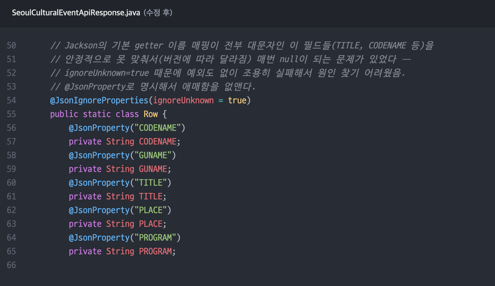
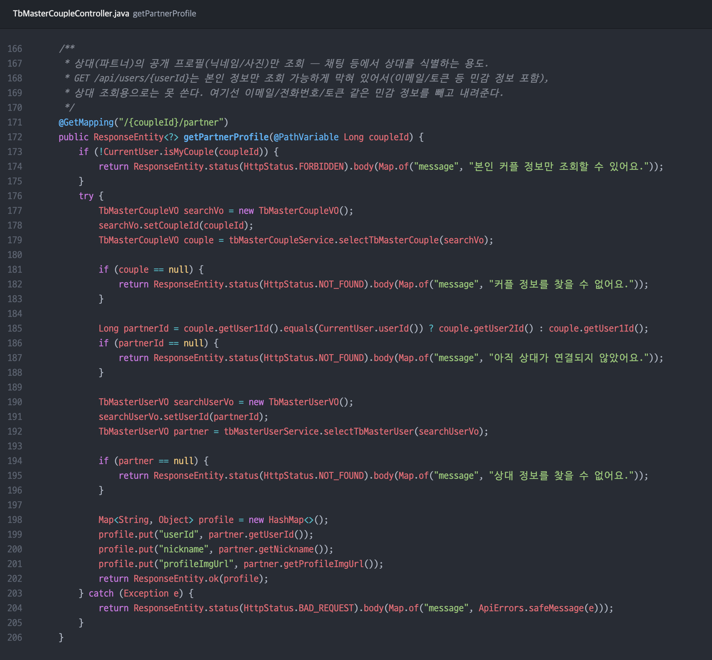
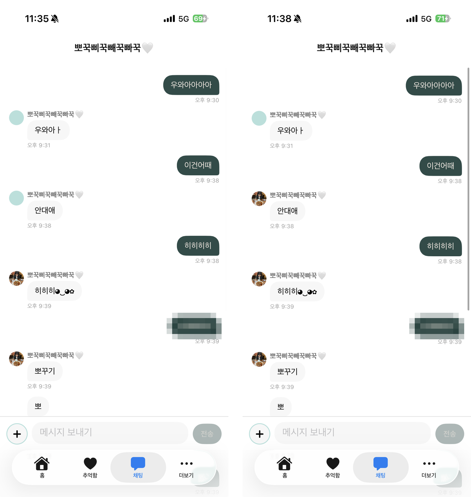

## 개요

- 우린을 만들면서 커밋 메시지에 **"진짜 원인"** 이라고 적은 버그가 여럿 있다.
  - 첫 번째로 고친 게 원인이 아니었고, 한 번 더 파고 나서야 찾았다는 뜻이다.
- 돌아보니 셋 다 공통점이 있었다. **에러가 안 났다.**
  - 예외도, 빨간 로그도, 크래시도 없이 "그냥 안 되는" 상태였다.
- 이번 글은 그 세 가지를 어떻게 찾았는지 정리한다.
  - 문화행사 동기화가 매번 **0건**
  - 채팅에서 상대 프로필이 **안 바뀜**
  - 채팅 프로필 사진이 **첫 줄만** 안 뜸

## 1. API는 응답이 잘 오는데 저장은 0건

### 증상

- 우린에는 서울시 문화행사를 데이트 후보로 보여주는 기능이 있다.
  - 서울 열린데이터광장 API에서 매일 행사를 받아와 DB에 저장한다.
- 스케줄러는 매번 정상 종료했다. 에러 로그도 없었다. 그런데 **저장은 늘 0건**이었다.

### 찾기

- 일단 API 응답부터 의심했다. 키가 틀렸거나, 응답이 비었거나.
- 로그를 하나 넣었다. 응답의 전체 건수와 받은 행 수를 찍는다.

```java
logger.info("문화행사 API 응답: total={}, rowCount={}", total, rows == null ? "null" : rows.size());
```

- 결과는 **total도 rowCount도 정상**이었다. 행은 잘 왔다.
- 그러면 행 안의 값이 문제다. 확인해 보니 **필드가 전부 null**로 채워져 있었다.

### 원인: Jackson이 `TITLE`을 `title`로 읽는다

- API 응답은 필드 이름이 전부 대문자다.

```json
{ "TITLE": "...", "CODENAME": "...", "GUNAME": "...", "STRTDATE": "..." }
```

- 받는 클래스도 원본 이름 그대로 만들었다.


- Jackson은 필드가 private이면 **getter/setter 이름에서** 프로퍼티 이름을 만든다.
  - `setTITLE` → 앞의 `set`을 떼고 → `TITLE` → 기본 규칙은 **앞쪽 대문자들을 소문자로** 바꾼다 → `title`
  - 그래서 Jackson이 기다리는 키는 `title`이고, JSON의 `TITLE`은 "모르는 필드"가 된다.
- 여기에 `ignoreUnknown = true`가 붙어 있었다.
  - 모르는 필드는 **조용히 버린다.** 예외가 없으니 모든 필드가 null인 객체가 정상적으로 만들어졌다.
- 외부 API 응답이 바뀌어도 안 깨지게 하려고 넣은 설정이, 이번엔 매핑 실패를 숨겼다.

### 해결

- 필드마다 JSON 이름을 명시했다.



## 2. 상대 프로필이 안 바뀐다 → 사실은 403

### 증상

- 상대가 프로필 사진과 닉네임을 바꿔도, 내 채팅 화면엔 예전 것이 그대로였다.

### 첫 번째 가설: 한 번만 불러와서

- 코드를 보니 상대 정보를 **채팅 첫 진입 때 한 번만** 불러오고 있었다.
  - 소켓 중복 연결을 막으려고 "같은 커플이면 다시 설정 안 함" 가드를 넣었는데, 상대 정보 로딩도 그 안에 들어가 있었다.
- 채팅 탭에 들어올 때마다 상대 정보를 새로 받게 고쳤다.
- **그래도 안 바뀌었다.**

### 진짜 원인


- 이 `catch`가 에러를 삼키고 있었다. 찍어 보니 매번 **403**이었다.
- `GET /api/users/{userId}`는 **본인만** 조회할 수 있게 막아 둔 API다.
  - 이메일, 인증 토큰 같은 민감한 정보가 들어 있어서 당연한 제한이다.
  - 상대 id로 부르니 매번 거부됐고, 화면엔 처음 회원가입 때 받은 값이 남아 있었다.
- 즉 첫 번째 가설도 틀린 건 아니었지만, 그걸 고쳐도 **불러오는 요청 자체가 실패**하고 있었다.

### 해결

- 상대 프로필 전용 API를 만들었다. 닉네임과 사진만 내려준다.



- 권한을 풀어서 해결하지 않았다. 필요한 것만 담은 **다른 창구**를 만들었다.

## 3. 프로필 사진이 첫 줄만 안 뜬다

### 증상

- 채팅방을 열면 상대 프로필 사진이 **어떤 줄은 뜨고 어떤 줄은 빈 원**이었다. 특히 첫 줄이 자주 비었다.



- 같은 채팅방을 3분 간격으로 연 화면이다.
  - 왼쪽은 위 두 줄이, 오른쪽은 첫 줄만 빈 원이다. 열 때마다 비는 줄이 달라졌다.
- 프로필 사진을 제대로 설정해도 재현됐다.

### 첫 번째 가설: 캐시가 작아서

- 프로필 사진은 메시지 줄마다 따로 그린다. 같은 URL이 수십 번 나온다.
- SwiftUI `AsyncImage`는 `URLCache.shared`를 쓰는데, 기본 용량이 **메모리 512KB / 디스크 10MB**다.
  - 사진 몇 장이면 밀려나서, 같은 사진을 줄마다 다시 요청하고, 요청이 몰리면 일부가 실패한다.
- 캐시를 50MB / 200MB로 키웠다. (서버 이미지 응답에 `Cache-Control` 헤더가 있어야 캐시가 효과를 낸다)
- 빈 원이 줄었지만 **첫 줄은 여전히 가끔 비었다.**

### 진짜 원인

- 채팅방을 막 열면 여러 줄의 프로필 요청이 **한꺼번에** 나간다. 캐시가 아직 비어 있는 첫 순간이다.
- 이때 하나가 실패하면, `AsyncImage`는 **다시 시도하지 않는다.**
  - 실패 상태(`.failure`)로 끝나고, 화면을 다시 그릴 때까지(앱 재실행 등) 빈 채로 남는다.
- 실패하면 1초 뒤에 최대 3번 다시 시도하는 `RetryingAsyncImage`로 감쌌다.


- 나중엔 채팅 사진이 많아지면서 화면 크기로 줄여 메모리에 캐시하는 `CachedAsyncImage`로 한 번 더 바꿨다.

## 정리

- 셋 다 **실패가 조용했다.**
  - `ignoreUnknown = true`가 매핑 실패를 삼켰다.
  - 빈 `catch`가 403을 삼켰다.
  - `AsyncImage`가 실패를 빈 원으로 바꾸고 끝냈다.
- 그래서 첫 번째 가설은 그럴듯했지만 틀렸거나, 절반만 맞았다.
  - 2번과 3번은 첫 수정이 **실제로 있던 다른 문제**를 고쳤다. 그래서 "고쳤다"고 착각하기 쉬웠다.
- 그 뒤로 지키는 것
  - "부가 기능이라 실패해도 괜찮다"는 `catch`라도 **로그는 남긴다.** 화면을 안 깨뜨리는 것과 실패를 숨기는 건 다르다.
  - 외부 응답을 받는 클래스는 이름이 같아 보여도 **`@JsonProperty`로 명시한다.**
  - 증상을 고친 뒤엔 **원래 재현 조건으로 다시** 확인한다. 줄었다고 사라진 건 아니다.

## Reference

<https://github.com/FasterXML/jackson-databind/wiki/Mapper-Features>

<https://developer.apple.com/documentation/swiftui/asyncimage>

<https://developer.apple.com/documentation/foundation/urlcache>
