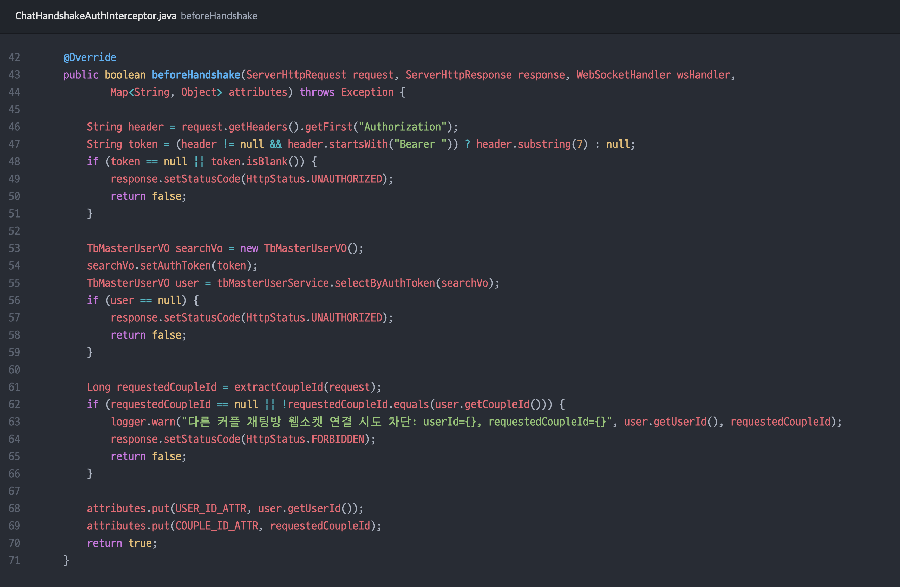
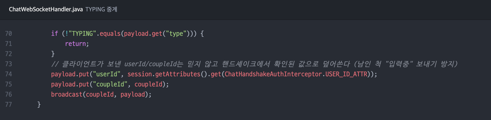
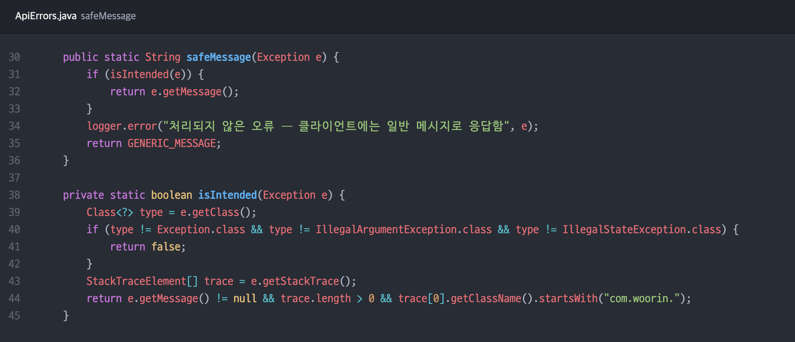
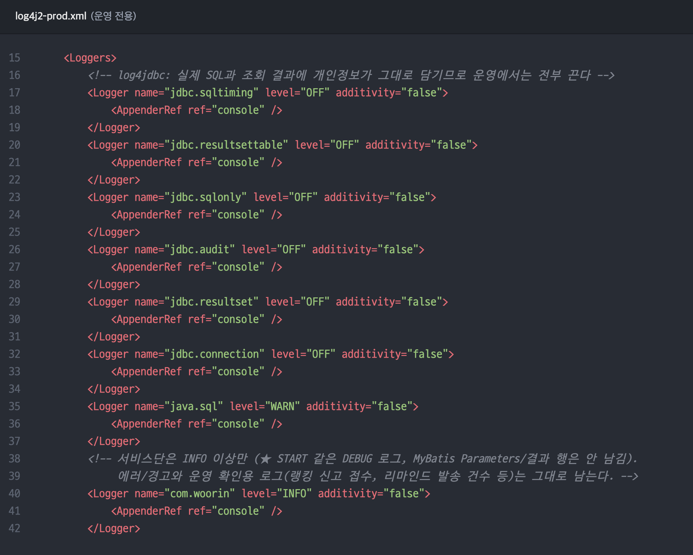

## 개요

- 우린은 여자친구와 둘이 쓰려고 만든 앱이라, 보안은 "로그인만 되면 됐다" 정도로 생각했다.
- 그런데 한 번 점검해 보니 세 군데가 뚫려 있었다.
  - **채팅 웹소켓에 인증이 없었다.** 숫자 하나만 바꾸면 남의 커플 채팅을 실시간으로 볼 수 있었다.
  - 에러가 나면 **DB 오류 메시지가 그대로** 앱에 내려갔다.
  - 운영 서버 로그에 **인증 토큰과 채팅 내용이 평문으로** 쌓이고 있었다.
- 셋 다 "둘이 쓸 때"는 문제가 드러날 일이 없었다는 공통점이 있다.

## 1. coupleId만 바꾸면 남의 채팅이 보였다

- REST API는 인증 필터(`AuthTokenFilter`)가 `Authorization: Bearer 토큰`을 확인한다.
- 그런데 이 필터는 **`/api/**`만** 본다. 채팅 웹소켓 주소는 `/ws/chat?coupleId=1`이다.
  - 토큰 없이 붙어도 연결됐고,
  - `coupleId=2`, `coupleId=3`… 으로 바꿔 붙으면 그 커플의 새 메시지, 읽음, 입력 중 이벤트가 실시간으로 들어왔다.
- 웹소켓은 HTTP로 시작해서(핸드셰이크) 프로토콜을 바꾸는 구조라, **서블릿 필터 경로 설정에서 빠지기 쉽다.** REST를 막았다고 소켓까지 막힌 게 아니었다.

### 핸드셰이크에서 막기

- Spring의 `HandshakeInterceptor`로 연결이 성립되기 전에 확인한다.
  - 토큰으로 회원을 찾고, 요청한 coupleId가 **그 회원의 커플일 때만** 연결을 허용한다.
  - 토큰이 없거나 틀리면 401, 남의 커플이면 403.



```java
registry.addHandler(chatWebSocketHandler, "/ws/chat")
        .addInterceptors(chatHandshakeAuthInterceptor)
        .setAllowedOrigins("*");
```

### 연결 후에도 클라이언트 값을 믿지 않기

- 연결만 막으면 끝일까? 소켓으로 **앱이 직접 보내는** 메시지가 하나 있다. "입력 중" 이벤트다.

```json
{ "type": "TYPING", "coupleId": 1, "userId": 2, "isTyping": true }
```

- 여기 담긴 `userId`를 그대로 중계하면, 상대인 척 "입력 중"을 띄울 수 있다.
- 핸들러는 클라이언트가 보낸 `userId`, `coupleId`를 **핸드셰이크에서 검증된 값으로 덮어쓴다.**



- 앱은 소켓을 열 때 REST와 같은 토큰을 헤더에 싣는다. (`URLSessionWebSocketTask`는 `URLRequest`로 헤더를 넣을 수 있다)
- 대가도 있었다. **토큰을 안 보내는 이전 앱 빌드는 실시간 연결이 거부된다.**
  - 메시지 보내기와 목록 조회는 REST라 동작은 하지만, 새 메시지가 바로 안 뜬다.
  - 사용자가 많다면 한동안 토큰 없는 연결도 받아주는 유예 기간을 두는 게 맞다.

## 2. 에러 메시지에 테이블 이름이 실려 나갔다

- 컨트롤러 대부분이 이런 모양이었다. 세어 보니 **86곳**이었다.

```java
} catch (Exception e) {
    return ResponseEntity.status(HttpStatus.BAD_REQUEST).body(Map.of("message", e.getMessage()));
}
```

- 서비스에서 일부러 던진 `"이미 가입된 이메일입니다."` 같은 메시지를 앱에 보여주려고 만든 구조다.
- 그런데 DB 오류나 NPE가 나도 `e.getMessage()`가 그대로 나간다.
  - SQL 오류면 테이블명, 컬럼명, 쿼리 일부가 응답에 담긴다. 공격하는 쪽에겐 DB 구조 안내서다.
- 메시지를 그대로 보여줄 예외와 숨길 예외를 나누는 `ApiErrors.safeMessage(e)`를 만들었다.



- 클래스를 `instanceof`가 아니라 **정확히 같은지**로 비교한 이유
  - `NumberFormatException`은 `IllegalArgumentException`의 하위 클래스다. `instanceof`로 보면 `For input string: "abc"` 같은 라이브러리 메시지가 섞여 나간다.
- 스택의 맨 위가 `com.woorin`인지 보는 이유
  - JDK나 라이브러리 안에서 던진 `IllegalStateException`은 내부 메시지다. 우리 코드에서 `new` 한 것만 사용자용으로 본다.
- 컨트롤러가 아예 못 잡은 예외는 `@RestControllerAdvice`에서 500 + 같은 일반 문구로 바꾼다.
  - 잘못된 JSON, 없는 경로 같은 스프링 표준 예외는 `ResponseEntityExceptionHandler`를 상속해서 원래대로 400/404/405로 둔다.
- 원인은 사라지지 않는다. 응답 대신 **서버 로그로** 간다.

## 3. 서버 로그에 토큰과 채팅이 평문으로 남았다

- 개발할 때 쓰던 log4jdbc 설정을 운영에서도 그대로 쓰고 있었다.
  - 실행된 SQL을 **바인딩 값까지 채워서**, 조회 결과는 **표로** 찍는다.
- 운영에서 그대로 두면 서버 로그(journalctl)에 이런 것들이 남는다.
  - 로그인 조회 → 인증 토큰이 그대로
  - FCM 토큰 등록 → FCM 토큰이 그대로
  - 채팅 목록 조회 → 대화 내용이 결과 표로
- 로그는 DB보다 덜 지켜진다. 서버에 들어올 수 있는 사람이면 누구나 볼 수 있고, 오래 남는다.
- 운영 전용 설정(`log4j2-prod.xml`)을 따로 만들고 `application-prod.yml`에서 지정했다.



- 꺼버리면 운영에서 확인하던 로그도 사라진다.
  - 우린로그 리마인드 발송 건수, 인기 랭킹 저장 건수처럼 **개인정보 없이** 운영에 필요한 로그는 DEBUG → INFO로 올렸다.

## 정리

- **REST를 막았다고 소켓까지 막힌 게 아니다.** 필터가 어느 경로를 보는지 확인해야 한다.
- 인증은 연결 시점에 한 번 하고, 그 뒤로는 **클라이언트가 보낸 신원 값을 믿지 않고 서버가 검증한 값을 쓴다.**
- 에러 메시지와 로그는 둘 다 "개발할 때 편하라고" 만든 것이 운영에서 정보를 흘리는 통로가 됐다.
  - 응답에는 사용자가 알아야 할 것만, 원인은 서버 로그에만.
  - 그 로그에도 개인정보는 남기지 않는다.
- 둘이 쓸 때는 공격하는 사람이 없으니 드러나지 않는다. **사용자가 늘기 전에** 찾아서 다행이었다.

## Reference

<https://docs.spring.io/spring-framework/reference/web/websocket/server.html#websocket-server-handshake>

<https://owasp.org/www-community/Improper_Error_Handling>

<https://cheatsheetseries.owasp.org/cheatsheets/Logging_Cheat_Sheet.html>
